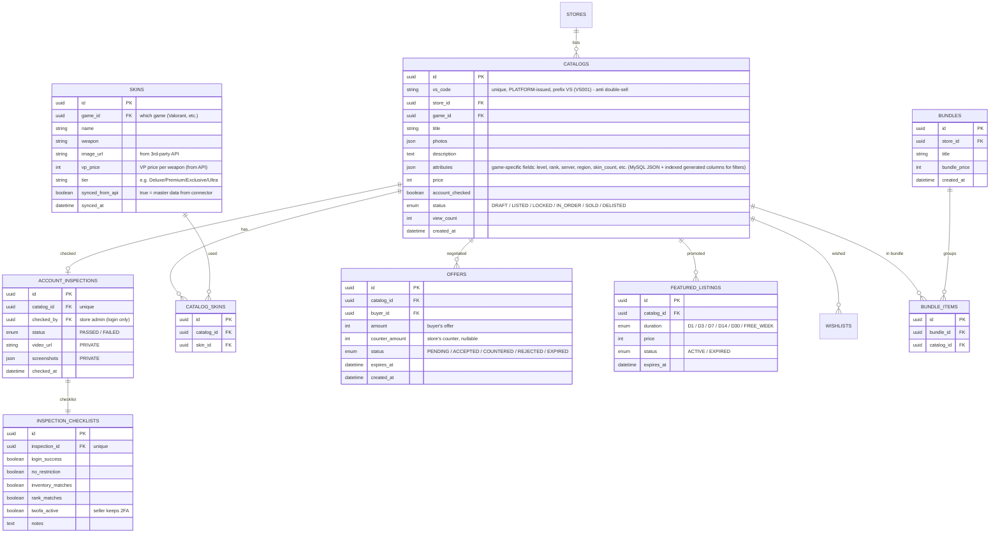
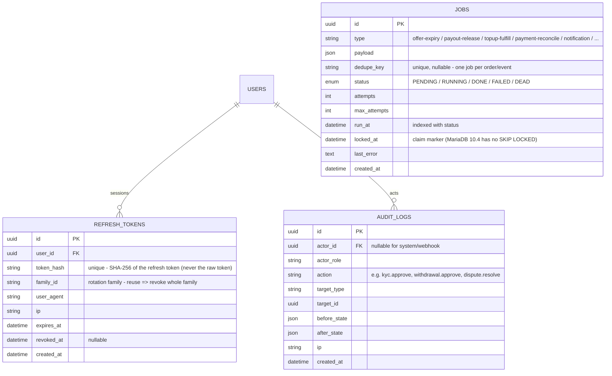

# ERD — valostock.id (Store-Only Marketplace)

**Source of Truth: Data Structure**
Version 6.0 · Express.js + Prisma + MySQL (MariaDB 10.4 via XAMPP) · Shopee-style

> **v6.0 changes:** Database **PostgreSQL → MySQL/MariaDB**; payments **Xendit → Midtrans** (Snap in, Iris out). `XENDIT_SUBACCOUNT` is replaced by an internal **`STORE_BALANCES` + `STORE_LEDGER`** (escrow + available balance per store). `PAYMENTS`, `WITHDRAWALS`, `TRANSFER_REQUESTS`, `PAYOUT_SPLITS`, `WEBHOOK_EVENTS` now reference Midtrans/Iris. Added infrastructure tables that replace Redis/BullMQ: **`REFRESH_TOKENS`**, **`JOBS`**, plus **`AUDIT_LOGS`**.
>
> **v5.0:** Store-only model. Sellers = **Stores** (KYC + deposit). Buyers free. Reseller stores + external sellers + transfer requests, mandatory 14/30-day protection, direct-offer/negotiation, rekber rooms (VS id), multi-channel notifications, Shopee-style engagement.
>
> Split into domain diagrams. All money mutations ledger-logged; sensitive media in private storage.

---

## 0. MySQL / MariaDB Type Mapping (applies to every diagram)

Diagram types are logical. `prisma/schema.prisma` (`provider = "mysql"`) maps them as follows:

| Diagram type | MySQL / MariaDB 10.4 column | Prisma |
|---|---|---|
| `uuid` | `CHAR(36)` | `String @id @default(uuid()) @db.Char(36)` |
| `string` | `VARCHAR(191)` (indexable under utf8mb4) | `String` / `@db.VarChar(n)` |
| `text` | `TEXT` / `MEDIUMTEXT` | `String @db.Text` |
| `int` (money, Rupiah) | `INT` (row), `BIGINT` (aggregates) | `Int` / `BigInt` |
| `decimal` (rates, scores) | `DECIMAL(5,4)` rates · `DECIMAL(4,2)` scores | `Decimal @db.Decimal(p,s)` |
| `boolean` | `TINYINT(1)` | `Boolean` |
| `datetime` | `DATETIME(3)`, stored UTC | `DateTime @db.DateTime(3)` |
| `enum` | `ENUM(...)` | Prisma `enum` |
| `json` | `JSON` (= `LONGTEXT` + `JSON_VALID` in MariaDB) | `Json` |

- **Engine** InnoDB, **charset** `utf8mb4_unicode_ci`. Every FK is indexed.
- **JSON filtering:** MariaDB/Prisma cannot filter JSON paths, so hot filter keys of `CATALOGS.attributes` (rank, region, server, skin_count) are exposed as **indexed VIRTUAL generated columns** created in a raw-SQL migration.
- **Money is never floating point.** Ledger tables are append-only (no UPDATE/DELETE from app code).

---

## A. Identity, Stores & Trust

```mermaid
erDiagram
    USERS ||--o{ STORE_ADMINS : "operates"
    USERS ||--o{ ORDERS : "buys"
    USERS ||--o{ RATINGS : "writes"
    USERS ||--o{ WISHLISTS : "saves"
    USERS ||--o{ STORE_FOLLOWS : "follows"
    USERS ||--o{ LOYALTY_LEDGER : "earns"
    USERS ||--o{ SANCTIONS : "receives"

    STORES ||--o{ STORE_ADMINS : "has"
    STORES ||--o| STORE_KYC : "verified"
    STORES ||--o| STORE_DEPOSIT : "holds"
    STORES ||--o| STORE_SUBSCRIPTION : "subscribes"
    STORES ||--o| STORE_BALANCES : "has"
    STORES ||--o{ EXTERNAL_SELLERS : "manages"
    STORES ||--o{ CATALOGS : "sells"
    STORES ||--o{ TRUST_SCORES : "scored"
    STORES ||--o{ NOTIFICATION_CHANNELS : "connects"
    STORES ||--o{ STORE_VOUCHERS : "issues"

    USERS {
        uuid id PK
        string email "unique, verified"
        string phone_number "nullable until verified (unique)"
        boolean phone_verified "OTP required before transacting"
        string password_hash "nullable (null for Google-only users)"
        enum auth_provider "EMAIL / GOOGLE"
        string google_id "nullable, unique - links Google account"
        enum role "buyer / store_admin / platform_admin"
        boolean is_banned
        boolean twofa_enabled "required admin/store_admin"
        int loyalty_points
        datetime created_at
    }

    STORES {
        uuid id PK
        string slug "unique: /store/xxx"
        string name
        string logo_url
        string banner_url "custom homepage"
        enum type "OWNER / RESELLER"
        enum level "AUTHORIZED / VERIFIED / PLATINUM"
        enum status "PENDING / ACTIVE / SUSPENDED"
        decimal rating_avg
        decimal service_score
        decimal recall_rate
        datetime created_at
    }

    STORE_KYC {
        uuid id PK
        uuid store_id FK "unique"
        enum provider "SUMSUB"
        string applicant_id
        enum status "PENDING / APPROVED / REJECTED"
        string result_ref
        datetime reviewed_at
    }

    STORE_ADMINS {
        uuid id PK
        uuid store_id FK
        uuid user_id FK
        enum role "owner / admin"
        datetime created_at
    }

    STORE_DEPOSIT {
        uuid id PK
        uuid store_id FK "unique"
        int amount "500000"
        enum status "HELD / PARTIAL_USED / RELEASED"
        datetime created_at
    }

    STORE_SUBSCRIPTION {
        uuid id PK
        uuid store_id FK "unique"
        enum tier "FREE / PRO / BUSINESS"
        decimal commission_rate "0.05 / 0.045 / 0.04"
        int max_listings
        enum status "ACTIVE / PAST_DUE / CANCELLED"
        datetime current_period_end
    }

    EXTERNAL_SELLERS {
        uuid id PK
        uuid store_id FK "the responsible store"
        string alias "store's label for the seller"
        string id_ref_encrypted "KTP held by STORE"
        string payout_channel "bank/e-wallet"
        string payout_account
        string payout_name
        datetime created_at
    }

    TRUST_SCORES {
        uuid id PK
        uuid subject_id FK
        enum subject_type "STORE / BUYER / PRODUCT"
        int score
        int txn_count
        decimal dispute_rate
        datetime updated_at
    }

    SANCTIONS {
        uuid id PK
        uuid target_id FK "store or user"
        enum target_type "STORE / BUYER"
        enum type "WARNING / RESTRICT / DEPOSIT_FINE / SUSPEND_30D / PERMANENT_BAN"
        int fine_amount
        text reason
        datetime created_at
    }

    NOTIFICATION_CHANNELS {
        uuid id PK
        uuid store_id FK
        enum kind "WHATSAPP / DISCORD / TELEGRAM"
        string target "number / webhook / chat_id"
        boolean active
        datetime created_at
    }
```

---

## B. Catalog, Offers, Inspection & Ads

---

## C. Commerce, Money, Rekber & Disputes

```mermaid
erDiagram
    CATALOGS ||--o{ ORDERS : "sold via"
    ORDERS ||--o{ PAYMENTS : "paid"
    ORDERS ||--|| ESCROW_HOLDS : "held"
    ORDERS ||--o| PAYOUT_SPLITS : "split"
    ORDERS ||--o| ORDER_PROTECTIONS : "protected"
    ORDERS ||--o| LOCKS : "locked"
    ORDERS ||--o| REKBER_ROOMS : "rekber"
    ORDERS ||--o| DISPUTES : "disputed"
    ORDERS ||--o| RATINGS : "rated"
    ORDERS ||--o| TRANSFER_REQUESTS : "pays ext. seller"
    STORES ||--o{ WITHDRAWALS : "withdraws"
    STORES ||--o{ STORE_LEDGER : "moves"
    STORE_BALANCES ||--o{ STORE_LEDGER : "summarised by"
    STORE_LEDGER }o--o| WITHDRAWALS : "debit"
    STORE_LEDGER }o--o| TRANSFER_REQUESTS : "debit"
    PAYMENTS ||--o{ WEBHOOK_EVENTS : "confirmed"
    REKBER_ROOMS ||--o{ CHAT_MESSAGES : "messages"
    DISPUTES ||--o{ DISPUTE_TIMELINE : "events"

    STORE_BALANCES {
        uuid id PK
        uuid store_id FK "unique"
        int escrow "held for PAID/IN_REKBER/SAFE orders (not withdrawable)"
        int available "released, withdrawable"
        datetime updated_at "row locked FOR UPDATE on every change"
    }

    STORE_LEDGER {
        uuid id PK
        uuid store_id FK
        enum type "ESCROW_HOLD / ESCROW_RELEASE / COMMISSION / REFUND / WITHDRAW / WITHDRAW_FEE / TRANSFER / TRANSFER_FEE / PAYOUT_REVERSAL / DEPOSIT_DEDUCTION / ADJUSTMENT"
        enum bucket "ESCROW / AVAILABLE"
        int amount "signed Rupiah"
        int balance_after "bucket balance after this row"
        string ref_type "order / withdrawal / transfer / dispute"
        uuid ref_id
        string idempotency_key "unique, nullable"
        datetime created_at
    }

    ORDERS {
        uuid id PK
        uuid catalog_id FK
        uuid buyer_id FK
        uuid store_id FK
        int item_price
        int handling_fee "max(3.5%, 4000) - buyer"
        int protection_fee "5000 - buyer"
        int commission "5% - from store"
        int total_paid "item + handling + protection"
        int store_receives "item - commission"
        enum status "PENDING_PAYMENT / PAID / IN_REKBER / SAFE / COMPLETED / REFUNDED / CANCELLED / DISPUTED"
        datetime safe_at "account safe (email code)"
        datetime completed_at
        datetime created_at
    }

    PAYMENTS {
        uuid id PK
        enum purpose "ORDER / TOPUP / BALANCE_FILL / STORE_DEPOSIT / SUBSCRIPTION / ADS"
        uuid ref_id "order / topup_order / balance_topup / store id"
        string midtrans_order_id "unique - our invoice no sent to Snap"
        string snap_token
        string redirect_url
        string payment_type "qris / bank_transfer / echannel / gopay / shopeepay / cstore / credit_card"
        string midtrans_transaction_id
        int amount "gross_amount, must match webhook"
        enum status "PENDING / PAID / EXPIRED / FAILED / REFUNDED"
        boolean signature_verified
        datetime expires_at
        datetime paid_at
    }

    WEBHOOK_EVENTS {
        uuid id PK
        uuid payment_id FK "nullable (Iris/Digiflazz/Sumsub events)"
        enum source "MIDTRANS / IRIS / DIGIFLAZZ / SUMSUB"
        string external_id "unique with source - idempotency"
        json raw_payload
        boolean signature_valid
        boolean processed
        datetime received_at
    }

    ESCROW_HOLDS {
        uuid id PK
        uuid order_id FK "unique"
        int amount
        enum status "HELD / RELEASED / REFUNDED"
        datetime released_at
    }

    PAYOUT_SPLITS {
        uuid id PK
        uuid order_id FK "unique"
        int to_platform "commission"
        int to_store "item - commission (credited to STORE_BALANCES.available)"
        uuid ledger_entry_id "STORE_LEDGER ESCROW_RELEASE row"
        enum status "PENDING / SETTLED"
    }

    ORDER_PROTECTIONS {
        uuid id PK
        uuid order_id FK "unique"
        int fee "5000"
        enum tier "STD_14D / HIGH_30D"
        datetime protection_until
        boolean is_optional_extra
    }

    LOCKS {
        uuid id PK
        uuid order_id FK "unique"
        int fee "5000"
        datetime expires_at "30 min"
    }

    TRANSFER_REQUESTS {
        uuid id PK
        uuid order_id FK "unique"
        uuid store_id FK
        uuid external_seller_id FK
        int amount
        int fee "4000 - covers Iris payout"
        string payout_channel "Iris bank code (bca/bni/gopay/...)"
        string account_number_encrypted
        string validated_name "Iris account validation"
        enum name_match "MATCH / REVIEW / MISMATCH"
        enum status "PENDING_VALIDATION / AWAITING_APPROVAL / PROCESSING / COMPLETED / FAILED"
        string iris_reference_no "unique"
        datetime available_after "safe_at + 5h"
        datetime completed_at
    }

    WITHDRAWALS {
        uuid id PK
        uuid store_id FK
        int amount
        int fee "4000 (+2500 bank tax)"
        string bank_code
        string account_number_encrypted
        string validated_name "Iris account validation"
        enum name_match "MATCH / REVIEW / MISMATCH"
        enum status "PENDING_VALIDATION / AWAITING_APPROVAL / PROCESSING / COMPLETED / FAILED"
        string iris_reference_no "unique"
        uuid approved_by FK "platform admin (maker-checker)"
        datetime completed_at
    }

    REKBER_ROOMS {
        uuid id PK
        uuid order_id FK "unique"
        string room_code "= catalog id, e.g. VS001"
        boolean admin_supervised
        enum status "ACTIVE / ARCHIVED"
        datetime created_at
    }

    CHAT_MESSAGES {
        uuid id PK
        uuid room_id FK
        uuid sender_id FK
        text content_encrypted "dispute evidence"
        json attachments "PRIVATE"
        datetime sent_at
    }

    DISPUTES {
        uuid id PK
        uuid order_id FK "unique"
        uuid raised_by FK
        enum reason "NOT_DELIVERED / NOT_AS_DESCRIBED / RECALL / SCAM / OTHER"
        enum status "OPEN / INVESTIGATING / RESOLVED_BUYER / RESOLVED_STORE / ARBITRATION"
        json evidence "delivery proof"
        datetime deadline "72h"
        datetime resolved_at
    }

    DISPUTE_TIMELINE {
        uuid id PK
        uuid dispute_id FK
        enum event "OPENED / STATEMENT / EVIDENCE / DEADLINE / RESOLVED"
        text detail
        datetime created_at
    }

    RATINGS {
        uuid id PK
        uuid order_id FK "unique - verified purchase"
        uuid store_id FK
        uuid buyer_id FK
        int overall "+1 / 0 / -1"
        int desc_accuracy "1-5"
        int attitude "1-5"
        int delivery_speed "1-5"
        text comment
        text store_reply "one reply allowed"
        datetime created_at
    }
```

---

## D. Engagement & Top-Up (Shopee-style)

```mermaid
erDiagram
    USERS ||--o{ WISHLISTS : "saves"
    USERS ||--o{ STORE_FOLLOWS : "follows"
    USERS ||--o{ RECENTLY_VIEWED : "views"
    USERS ||--o{ LOYALTY_LEDGER : "earns"
    USERS ||--o{ VOUCHER_REDEMPTIONS : "redeems"
    USERS ||--o{ TOPUP_ORDERS : "orders"
    USERS ||--o| BUYER_BALANCES : "has"
    USERS ||--o{ BALANCE_TOPUPS : "fills"
    USERS ||--o{ BALANCE_LEDGER : "moves"
    STORES ||--o{ STORE_VOUCHERS : "issues"
    STORES ||--o{ FLASH_SALES : "runs"
    STORES ||--o{ BANNER_ADS : "buys"
    STORE_VOUCHERS ||--o{ VOUCHER_REDEMPTIONS : "used"
    GAMES ||--o{ TOPUP_PRODUCTS : "has"
    TOPUP_PRODUCTS ||--o{ TOPUP_ORDERS : "purchased"
    TOPUP_PROMO_CODES ||--o{ TOPUP_ORDERS : "applied"

    WISHLISTS {
        uuid id PK
        uuid user_id FK
        uuid catalog_id FK
        boolean notify_price_drop
        datetime created_at
    }

    STORE_FOLLOWS {
        uuid id PK
        uuid user_id FK
        uuid store_id FK
        datetime created_at
    }

    RECENTLY_VIEWED {
        uuid id PK
        uuid user_id FK
        uuid catalog_id FK
        datetime viewed_at
    }

    LOYALTY_LEDGER {
        uuid id PK
        uuid user_id FK
        enum type "EARN / REDEEM"
        int points
        uuid ref_id "order"
        datetime created_at
    }

    STORE_VOUCHERS {
        uuid id PK
        uuid store_id FK
        string code
        enum kind "PERCENT / FIXED"
        int value
        int min_spend
        int quota
        datetime expires_at
    }

    VOUCHER_REDEMPTIONS {
        uuid id PK
        uuid voucher_id FK
        uuid user_id FK
        uuid order_id FK
        datetime created_at
    }

    FLASH_SALES {
        uuid id PK
        uuid store_id FK
        uuid catalog_id FK
        int sale_price
        datetime starts_at
        datetime ends_at
    }

    BANNER_ADS {
        uuid id PK
        uuid store_id FK
        enum placement "HOMEPAGE / CATEGORY / SEARCH"
        int price
        datetime starts_at
        datetime ends_at
    }

    GAMES {
        uuid id PK
        string name
        string slug "unique - used in URL /[slug]/account, /[slug]/topup"
        string icon_url
        boolean supports_account "sells accounts?"
        boolean supports_topup "sells top-up?"
        boolean has_skin_api "syncs skin master from 3rd-party API?"
        boolean is_hot "featured on home"
        int sort_order
        boolean is_active
    }

    TOPUP_PRODUCTS {
        uuid id PK
        uuid game_id FK
        string name
        int wholesale_price
        int retail_price
        string digiflazz_sku
    }

    TOPUP_ORDERS {
        uuid id PK
        string invoice_no "unique, e.g. TU-XXXX - for invoice check"
        uuid buyer_id FK "nullable (guest checkout)"
        uuid product_id FK
        uuid promo_code_id FK "nullable"
        string game_uid "player UID"
        string contact_email "receipt sent here"
        string contact_whatsapp "contacted if issue"
        enum pay_source "MIDTRANS / BALANCE"
        enum pay_method "QRIS / VA / RETAIL / EWALLET / CC (if MIDTRANS)"
        int base_price "retail"
        int payment_surcharge "per method (§8)"
        int discount "promo"
        int amount_paid
        int margin "retail - wholesale + surcharge net"
        string digiflazz_ref
        enum status "PENDING / PAID / PROCESSING / SUCCESS / FAILED / REFUNDED"
        datetime created_at
    }

    BUYER_BALANCES {
        uuid id PK
        uuid user_id FK "unique"
        int balance "BLC = Rupiah 1:1 - CLOSED-LOOP"
        datetime updated_at
    }

    BALANCE_TOPUPS {
        uuid id PK
        uuid user_id FK
        string invoice_no "unique, e.g. BL-XXXX"
        enum gateway "MIDTRANS"
        enum pay_method "QRIS / VA / RETAIL / EWALLET / CC"
        int nominal "face value added (preset denom)"
        int payment_surcharge
        int amount_paid
        enum status "PENDING / PAID / FAILED"
        datetime created_at
    }

    BALANCE_LEDGER {
        uuid id PK
        uuid user_id FK
        enum type "TOPUP_CREDIT / SPEND_TOPUP / REFUND_CREDIT / ADJUSTMENT"
        int amount
        int balance_after "audit trail"
        uuid ref_id "balance_topup or topup_order"
        datetime created_at
    }

    TOPUP_PROMO_CODES {
        uuid id PK
        string code "unique"
        enum kind "PERCENT / FIXED"
        int value
        int min_spend
        int quota
        int used_count
        datetime expires_at
        boolean is_active
    }
```

---

## E. Content (CMS), RBAC, Affiliate, Reports & Notifications

```mermaid
erDiagram
    USERS ||--o| AFFILIATES : "is affiliate"
    USERS ||--o{ REFERRALS : "referred"
    USERS ||--o{ REPORTS : "files"
    USERS ||--o{ NOTIFICATIONS : "receives"
    USERS ||--o{ ADMIN_USER_ROLES : "assigned"
    AFFILIATES ||--o{ REFERRALS : "brings"
    ADMIN_ROLES ||--o{ ADMIN_USER_ROLES : "granted"
    ADMIN_ROLES ||--o{ ROLE_PERMISSIONS : "has"
    PERMISSIONS ||--o{ ROLE_PERMISSIONS : "in"
    GAMES ||--o{ GAME_FIELD_TEMPLATES : "defines (phase 2)"

    ARTICLES {
        uuid id PK
        string slug "unique"
        string title
        string cover_url
        text body "rich text"
        string category
        uuid author_id FK "admin user"
        enum status "DRAFT / SCHEDULED / PUBLISHED / ARCHIVED"
        int view_count
        datetime published_at
        datetime created_at
        datetime updated_at
    }

    HELP_ARTICLES {
        uuid id PK
        string slug "unique"
        string title
        text body
        enum category "GETTING_STARTED / BECOMING_STORE / FEES_WITHDRAWAL / BEFORE_SALE / AFTER_SALE / DISPUTES / TOPUP / BALANCE / PENALTIES / SECURITY"
        int sort_order
        enum status "DRAFT / PUBLISHED"
        int helpful_count
        uuid author_id FK
        datetime created_at
    }

    ADMIN_ROLES {
        uuid id PK
        string name "unique, e.g. Article Creator"
        string description
        boolean is_system "Super Admin etc."
        datetime created_at
    }

    PERMISSIONS {
        uuid id PK
        string key "unique, e.g. articles:create"
        string module "articles / disputes / finance / ..."
        string action "view/create/edit/delete/publish/approve/resolve/manage"
        string description
    }

    ROLE_PERMISSIONS {
        uuid id PK
        uuid role_id FK
        uuid permission_id FK
    }

    ADMIN_USER_ROLES {
        uuid id PK
        uuid user_id FK "USERS with role platform_admin"
        uuid role_id FK
        uuid assigned_by FK
        datetime created_at
    }

    AFFILIATES {
        uuid id PK
        uuid user_id FK "unique"
        string code "unique referral code"
        int total_referred
        int total_earned "credited to BALANCE (closed-loop)"
        datetime created_at
    }

    REFERRALS {
        uuid id PK
        uuid affiliate_id FK
        uuid referred_user_id FK
        enum status "PENDING / QUALIFIED / REWARDED"
        int reward_amount "to balance"
        uuid ref_order_id "qualifying order"
        datetime created_at
    }

    REPORTS {
        uuid id PK
        uuid reporter_id FK
        enum target_type "STORE / CATALOG / USER / ORDER"
        uuid target_id
        enum reason "SCAM / FAKE / OFF_PLATFORM / ABUSE / OTHER"
        text detail
        enum status "OPEN / REVIEWING / RESOLVED / DISMISSED"
        uuid handled_by FK "admin"
        datetime created_at
    }

    NOTIFICATIONS {
        uuid id PK
        uuid user_id FK
        enum kind "ORDER / SYSTEM"
        string title
        text body
        string ref_type "order/dispute/store/..."
        uuid ref_id
        boolean is_read
        datetime created_at
    }

    GAME_FIELD_TEMPLATES {
        uuid id PK
        uuid game_id FK
        string field_key "e.g. rank, server, level"
        string label
        enum type "TEXT / NUMBER / SELECT / IMAGE / SKIN_LIST / BOOLEAN"
        enum source "MANUAL / API"
        boolean required
        json options "for SELECT"
        string group_label
        int sort_order
    }
```

---

## F. Platform Infrastructure (replaces Redis/BullMQ) & Audit

**1. Store-only.** Sellers are `STORES` (KYC + deposit). `USERS.role` has no individual seller. Reseller stores manage `EXTERNAL_SELLERS` — the store holds their KTP and full responsibility; the platform only knows/sanctions the store.

**2. Ledger-tracked funds (Midtrans).** Buyer payments land in the platform's Midtrans merchant account; each store's share is tracked in `STORE_BALANCES` (`escrow` + `available`) and every movement is an append-only `STORE_LEDGER` row. `PAYOUT_SPLITS` records commission vs store share at completion. `WITHDRAWALS` and `TRANSFER_REQUESTS` debit the store's `available` bucket and are paid out via **Midtrans Iris** after account validation + admin approval. Escrow and float are never used for operations (see ARCHITECTURE §5 custody note).

**3. Anti double-sell.** `CATALOGS.id` is platform-issued (prefix VS); one account = one catalog.

**4. Rekber room = evidence.** `REKBER_ROOMS` (code = catalog id, admin-supervised) + `CHAT_MESSAGES` are the dispute trail, separate from normal chat.

**5. Protection is support, not a hold.** `ORDER_PROTECTIONS` records the 14/30-day support window; payout still releases at `safe_at + 5h`.

**6. Transfer to external seller is gated.** `TRANSFER_REQUESTS.available_after = safe_at + 5h`, with Iris account validation (`validated_name`, `name_match`) and admin approval before sending; `fee` covers the Iris payout cost.

**7. Provable inspection.** `ACCOUNT_INSPECTIONS` + checklist (login-only, seller keeps 2FA) back the "Account Checked" badge.

**8. Payment integrity.** Midtrans `signature_key` verified + status re-fetched + `gross_amount` matched (`signature_verified`), and `WEBHOOK_EVENTS` (unique `source + external_id`) makes replays no-ops — all before any state change.

**9. Notifications are one-way.** `NOTIFICATION_CHANNELS` (WhatsApp/Discord/Telegram) alert stores; transactions stay in-app.

**10. Balance is CLOSED-LOOP (top-up only).** `BUYER_BALANCES` + `BALANCE_TOPUPS` (filled via Midtrans) + `BALANCE_LEDGER` (auditable). Rules enforced in code: balance can be spent **only on game top-up**, **cannot be cashed out**, **cannot buy accounts**, **cannot transfer to other users**. This keeps it a closed-loop stored value (not e-money → no BI licence). Float is a **liability** to buyers — held separately, never used for operations.

**11. Multi-game is flexible by design.** A store sells across many games (each `CATALOG` has `game_id`). Game-specific listing fields (level, rank, server, skin count…) live in `CATALOGS.attributes` (**MySQL JSON**; hot filter keys exposed as indexed generated columns) — so a new game needs **no table redesign** (only an optional generated column if a new key must be filterable). `SKINS` is a master catalog synced from a 3rd-party API (image + VP price per weapon); stores pick skins → `CATALOG_SKINS`. URLs are per-game: `/[slug]/account`, `/[slug]/topup`. **Phase 1: games/types added by code (seed).** Phase 2: an admin CMS + dynamic field templates (`GAME_FIELD_TEMPLATES`) can manage fields no-code — the JSONB structure already supports it without migration.

**12. RBAC is granular & server-enforced.** `PERMISSIONS` (`module:action`) → `ROLE_PERMISSIONS` → `ADMIN_ROLES` → `ADMIN_USER_ROLES` (assigned to `USERS` with role `platform_admin`). Guards check permissions per resource (never UI-only). Only Super Admin manages RBAC; assignments are audit-logged. Example: an "Article Creator" role holds only `articles:create` + `articles:edit_own`.

**13. Affiliate rewards stay closed-loop.** `AFFILIATES` + `REFERRALS` credit `total_earned` to the buyer's **Balance (BLC)**, never cash — consistent with the closed-loop model (no hidden cash-out path).

**14. CMS & content.** `ARTICLES` (news) and `HELP_ARTICLES` (iGV-style help) are managed via the admin CMS, gated by article/help permissions. `NOTIFICATIONS` power the in-app Order/System notification tabs. `REPORTS` feed the admin reports queue.

**15. Auth: email/password + Google.** `auth_provider` = EMAIL or GOOGLE; Google users have `google_id` and no `password_hash`. **Account linking:** if a Google email matches an existing account, link it (never create a duplicate). Google is a fast entry, but **phone OTP (`phone_verified`) is still required before transacting** (needed for order notifications & dispute contact).

**16. Sessions & jobs live in MySQL.** `REFRESH_TOKENS` (hashed, rotating, revocable) replaces Redis-based revocation; `JOBS` (+ node-cron) replaces BullMQ queues; `AUDIT_LOGS` records every sensitive admin/financial action with IP.

## Removed from older versions
- `XENDIT_SUBACCOUNT`, Xendit split/disbursement refs (v6 → `STORE_BALANCES`/`STORE_LEDGER` + Midtrans Iris)
- PostgreSQL-only features (JSONB/GIN) (v6 → MySQL JSON + generated columns)
- Individual seller role, seller levels, seller KYC fee (store-only now)
- Posting fee, by-self/by-platform pricing (commission model instead)
- Native-app KYC, WA transaction bot, account custody, universal warranty hold
