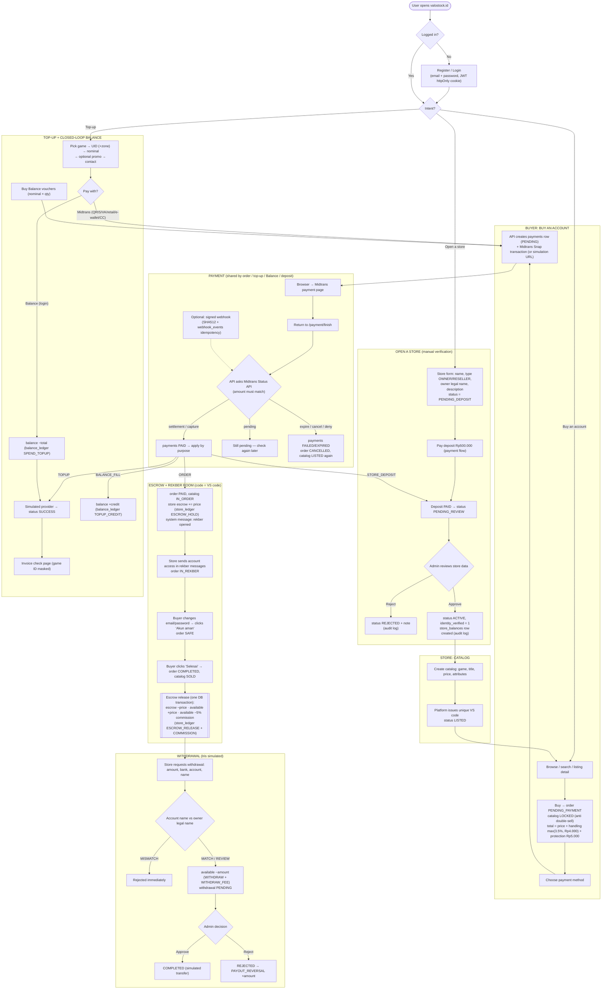

# Mega Flowchart — valostock.id (v7.0, Prototype)

End-to-end flow of the **prototype**: Buyer, Store, Admin, and Midtrans, across `front/` (Next.js), `back/` (Express + mysql2) and MySQL (XAMPP). Store verification is **manual by an admin** (no KYC provider). Midtrans Snap runs in Sandbox (or simulation mode). Top-up fulfilment and payouts are **simulated**.

> For the assignment's formal model (Diagram Konteks, DFD, ERD, conceptual DB, table structure) see [`docs/modeling/`](modeling/README.md). This page is an end-to-end overview flowchart. Paste the code into mermaid.live to view it.

## How to read it

- **One payment flow for everything.** Orders, top-ups, Balance fills and store deposits all create a `payments` row. Only Midtrans' own answer (Status API or signed webhook) can mark it PAID, and the effect depends on `purpose`.
- **Money always leaves a trail.** Every change to `users.balance` or `store_balances` writes a ledger row (`balance_ledger` / `store_ledger`) with `balance_after`, inside the same DB transaction.
- **Prototype simplifications:** escrow is released on *Selesai* (no 5-hour timer); withdrawals are completed by admin approval (Iris simulated); top-up delivery is simulated; disputes, offers, ratings and notifications are future work.
