# Mega Flowchart — valostock.id (v6.0, Store-Only)

End-to-end system flow: Buyer, Store (Owner/Reseller), External Seller, Platform Admin, across Next.js web (`front/`) + Express.js API (`back/`) + MySQL (XAMPP). Store-only marketplace: **Midtrans Snap** for every payment, **Midtrans Iris** for every payout, per-store escrow/available ledger, Sumsub store KYC, direct offers, rekber rooms, mandatory 14/30-day protection, transfer to external sellers. No WA transaction bot (WA/Discord/Telegram = notifications only).

> Paste into mermaid.live to view. Dashed lines (`-.->`) connect to the Platform Admin oversight block.

```mermaid
flowchart TD
    Start([User opens valostock.id]) --> Role{"Role / intent?"}
    Role -- Buyer --> B_Browse
    Role -- "Open a Store" --> S_Reg
    Role -- "Top-up" --> TU_Start

    %% ================= STORE ONBOARDING =================
    subgraph STORE_ONB["OPEN A STORE"]
        S_Reg["Register (OTP + email)"] --> S_Kyc["Sumsub KYC (FREE)"]
        S_Kyc --> S_KycOk{"KYC approved?"}
        S_KycOk -- No --> S_KycRetry["Retry / manual review"]
        S_KycRetry --> S_Kyc
        S_KycOk -- Yes --> S_Dep["Pay deposit Rp500K (Midtrans Snap)"]
        S_Dep --> S_Sub["Webhook PAID -> store ACTIVE + open STORE_BALANCES (escrow/available ledger)"]
        S_Sub --> S_Type{"Store type?"}
        S_Type -- "Owns accounts" --> S_Owner["Owner Store badge"]
        S_Type -- "Resells (external sellers)" --> S_Reseller["Reseller Store badge"]
    end
    S_Owner --> C_Create
    S_Reseller --> C_Create

    %% ================= LISTING + INSPECTION =================
    subgraph LIST["STORE: CREATE LISTING"]
        C_Create["Create listing (photos, price, description)"]
        C_Create --> C_Id["PLATFORM issues catalog id (VS001) - anti double-sell"]
        C_Id --> C_Insp{"Run Account Inspection?"}
        C_Insp -- "Yes (login-only + 2FA on)" --> C_Check["Checklist + timestamp + media -> Account Checked"]
        C_Insp -- No --> C_Live["Listing LISTED"]
        C_Check --> C_Live
        C_Live --> C_Promo{"Promote?"}
        C_Promo -- "Ads / featured / voucher / flash sale" --> C_Live
    end
    C_Live --> B_Browse

    %% ================= BUYER DISCOVER + NEGOTIATE =================
    subgraph BUY["BUYER: DISCOVER & NEGOTIATE"]
        B_Browse["Browse + search/filter (game/rank/price/skin/region)"]
        B_Browse --> B_Engage["Wishlist / follow store / recommendations"]
        B_Engage --> B_Detail["Listing detail (badges, VS id)"]
        B_Detail --> B_Offer{"Make an offer (Tawar)?"}
        B_Offer -- "Yes" --> O_Form["Offer form -> submit (has expiry)"]
        O_Form --> O_Store{"Store: Accept / Counter / Reject"}
        O_Store -- "Counter" --> O_Form
        O_Store -- "Reject / Expire" --> B_Detail
        O_Store -- "Accept (Yes/No)" --> O_Lock["Lock price + listing"]
        B_Offer -- "Buy directly" --> O_Lock
        O_Lock --> B_OptLock{"Optional lock Rp5.000 (30 min)?"}
        B_OptLock --> B_Pay["Pay: item + handling (max 3.5%/Rp4k) + protection Rp5.000<br/>API creates Midtrans Snap transaction -> redirect"]
    end
    B_Pay --> PAY_Hook

    %% ================= PAYMENT =================
    subgraph PAYFLOW["PAYMENT (Express webhook /api/webhooks/midtrans)"]
        PAY_Hook{"Midtrans notification valid?<br/>SHA512 signature + status re-check<br/>+ amount match + idempotency"}
        PAY_Hook -- "Invalid/duplicate" --> PAY_Drop["Reject / ignore (logged)"]
        PAY_Hook -- "Valid + settlement" --> PAY_Escrow["Order PAID -> STORE_LEDGER ESCROW_HOLD (store escrow bucket)"]
        PAY_Recon["payment-reconcile job polls Midtrans status (fallback when no webhook)"] -.-> PAY_Hook
    end
    PAY_Escrow --> RK_Open

    %% ================= REKBER + DELIVERY =================
    subgraph REKBER["REKBER ROOM (admin-supervised, code = VS id)"]
        RK_Open["Open Rekber Room (Socket.IO)"]
        RK_Open --> RK_Deliver["Store delivers account access"]
        RK_Deliver --> RK_Inspect["Buyer changes email/pass/2FA + inspects"]
        RK_Inspect --> RK_Ok{"OK & as described?"}
        RK_Ok -- "Scam / mismatch" --> DISPUTE
        RK_Ok -- "No valid reason to cancel" --> RK_Fee["Cancel -> cancellation fee"]
        RK_Fee --> DISPUTE
        RK_Ok -- "Yes (email code received)" --> RK_Safe["Account SAFE (start 5h timer)"]
    end
    RK_Safe --> SET_Complete

    %% ================= COMPLETION + PROTECTION =================
    SET_Complete["Buyer clicks COMPLETE (or auto after window)"] --> SET_Split[["ESCROW_RELEASE (payout-release job, safe_at + 5h):<br/>5% COMMISSION -> platform<br/>rest -> store AVAILABLE balance"]]
    SET_Split --> SET_Prot["Protection window opens: 14d (<=10jt) / 30d (>10jt) - support only"]
    SET_Prot --> SET_Trust["Update trust + Seller Rating + Service Score"]
    SET_Trust --> SET_Loyal["Buyer earns loyalty points"]

    %% ================= PAYOUT + TRANSFER =================
    subgraph PAYOUT["PAYOUT (5h after safe)"]
        SET_Loyal --> PO_Type{"Owner or Reseller?"}
        PO_Type -- "Owner: withdraw" --> PO_Val["Iris account validation: bank name == KYC?"]
        PO_Val --> PO_Match{"Match?"}
        PO_Match -- "Mismatch" --> PO_Reject["Reject / review"]
        PO_Match -- "Match" --> PO_Appr["Debit AVAILABLE (WITHDRAW + fee 4k)<br/>Admin approves Iris payout (maker-checker)"]
        PO_Appr --> PO_Pay["Midtrans Iris -> store bank"]
        PO_Pay -- "Iris failed" --> PO_Rev["PAYOUT_REVERSAL -> funds back to AVAILABLE"]
        PO_Type -- "Reseller: transfer to external seller" --> TR_Add["Add Transfer Request (input seller bank/e-wallet)"]
        TR_Add --> TR_Val["Iris account validation: recognize seller name"]
        TR_Val --> TR_Pay["Debit store AVAILABLE (TRANSFER + fee 4k)<br/>Admin approves -> Midtrans Iris -> seller"]
        TR_Pay --> TR_Notif["Notify external seller (WhatsApp)"]
    end
    PO_Pay --> Done([Funds received])
    TR_Notif --> Done

    %% ================= DISPUTE =================
    subgraph DISP["DISPUTE (72h + arbitration)"]
        DISPUTE["Status DISPUTED + timeline"]
        DISPUTE --> D_Evidence["Rekber chat + inspection + delivery proof"]
        D_Evidence --> D_Arb["Platform arbitrates (final)"]
        D_Arb --> D_Who{"Fault?"}
        D_Who -- "Store (incl. its external seller)" --> D_Refund["Refund buyer + deduct store deposit"]
        D_Refund --> SANCTION
        D_Who -- "Buyer false claim" --> D_Release["Release to store + buyer trust down"]
    end
    D_Release --> SET_Split

    %% ================= SANCTIONS =================
    subgraph SANC["SANCTIONS"]
        SANCTION["Tiered: warning -> restrict -> deposit fine -> suspend -> ban"]
        SANCTION --> SANC_Black["Blacklist device / KYC / bank"]
    end

    %% ================= TOP-UP =================
    subgraph TOPUP["TOP-UP (Midtrans Snap + Digiflazz) - no escrow"]
        TU_Start["Pick game -> UID -> nominal"]
        TU_Start --> TU_Promo["Optional promo code + contact (email + WhatsApp)"]
        TU_Promo --> TU_Src{"Pay with?"}
        TU_Src -- "Midtrans Snap (QRIS/VA/retail/ewallet/cc)" --> TU_Hook
        TU_Src -- "Balance (BLC, closed-loop)" --> TU_Bal["Deduct balance (BALANCE_LEDGER SPEND_TOPUP)"]
        TU_Bal --> TU_Api
        TU_Hook{"Midtrans webhook PAID?<br/>signature + idempotency"}
        TU_Hook -- Yes --> TU_Api["topup-fulfill job -> Digiflazz API"]
        TU_Api --> TU_Res{"Delivered?"}
        TU_Res -- Success --> TU_Done([Success - receipt to email/WA])
        TU_Res -- "Failed (currency not received)" --> TU_Refund["Refund to Balance (never cash)"]
        TU_Invoice["Invoice check page: 'Cek Invoice Kamu' by invoice no"]
        TU_Fill["Fill Balance via Midtrans Snap -> webhook PAID -> TOPUP_CREDIT (closed-loop, no cash-out)"] --> TU_Src
    end

    %% ================= ADMIN =================
    subgraph ADMIN["PLATFORM ADMIN (oversight, 2FA + audit)"]
        A_Task{"Queues"}
        A_Task --> A_Kyc["Store KYC review"]
        A_Task --> A_Rekber["Supervise rekber rooms"]
        A_Task --> A_Disp["Resolve / arbitrate disputes"]
        A_Task --> A_Fin["Approve Iris payouts + reconcile ledgers vs Midtrans"]
        A_Task --> A_Fraud["Fraud + sanctions + deposit deductions"]
        A_Task --> A_Catalog["Manage skins / top-up products"]
    end

    %% ---- admin links ----
    S_KycOk -.-> A_Kyc
    RK_Open -.-> A_Rekber
    DISPUTE -.-> A_Disp
    SET_Split -.-> A_Fin
    PO_Appr -.-> A_Fin
    SANCTION -.-> A_Fraud
    TU_Api -.-> A_Catalog
```

## How to read it

- **Top to bottom is one transaction's life:** open store (KYC + deposit + store ledger + type) → create listing (VS id + optional inspection) → buyer discovers & negotiates → pay via Midtrans Snap (item + handling + protection) → escrow → rekber room delivery → account safe → complete → escrow release (5% commission) → payout via Midtrans Iris (Owner withdraw / Reseller transfer to external seller).
- **Store-only:** only KYC+deposit stores sell. Reseller stores pay their external sellers via a **Transfer Request debited from their own balance**, paid out by Iris after name validation + admin approval.
- **Four money gates:** Midtrans webhook (signature + status re-check + idempotency) → escrow (ledger) → release at completion (ledger) → admin-approved Iris payout. Every step is a ledger row reconciled against Midtrans.
- **Protection is support (14/30 days), not a hold** — payout still releases 5h after the account is safe.
- **Rekber room** (admin-supervised, code = VS id) is the delivery + dispute evidence trail; separate from normal chat.
- **Dashed lines** show admin oversight (KYC, rekber, disputes, reconciliation, fraud, catalog).
