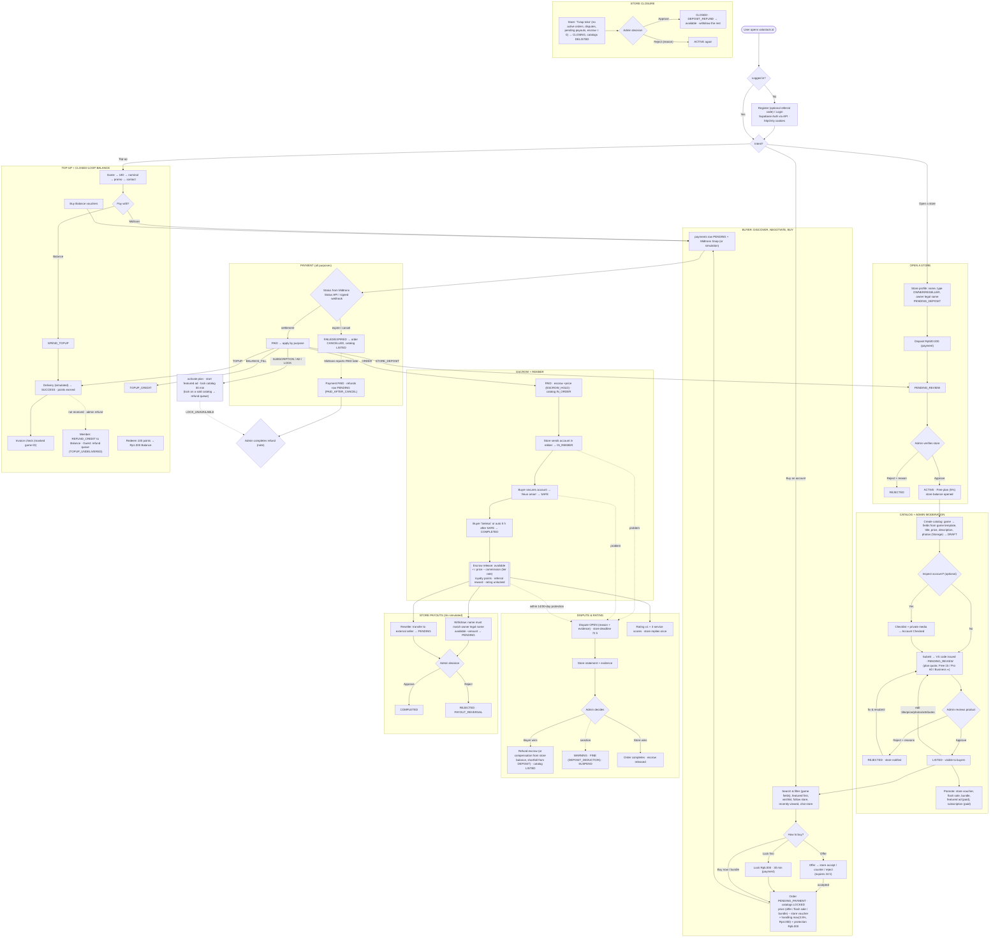

# Mega Flowchart — valostock.id (v8.0)

End-to-end flow across `front/` (Next.js), `back/` (Express) and the local Supabase project (Postgres + Auth + Storage). Stores **and every catalog** are verified by an admin. Midtrans Snap runs in Sandbox or simulation mode; Iris payouts, Digiflazz delivery and WhatsApp/Discord/Telegram are simulated.

> The assignment's formal model (Diagram Konteks, DFD, ERD, conceptual DB, table structure) is in [`docs/modeling/`](modeling/README.md). Admin screens: [`ADMIN_PANEL.md`](ADMIN_PANEL.md). Paste the code into mermaid.live to view it.

## How to read it

- **Two admin gates before anything is sold:** the store (identity + deposit) and **every catalog** (photos, game fields, description, price). Rejections always carry a reason, and the store can fix and resubmit.
- **One payment flow** for orders, top-ups, Balance, deposits, subscriptions, featured ads and locks. Only Midtrans' answer (or simulation mode) marks a payment PAID.
- **Money always leaves a trail:** `store_ledger`, `balance_ledger`, `loyalty_ledger` with `balance_after`, in the same DB transaction as the state change.
- **Timers are jobs:** unpaid orders (60 min), locks (30 min), offers (24 h), auto-complete (5 h after SAFE), flash sales, featured ads, subscriptions, dispute deadlines (72 h).
