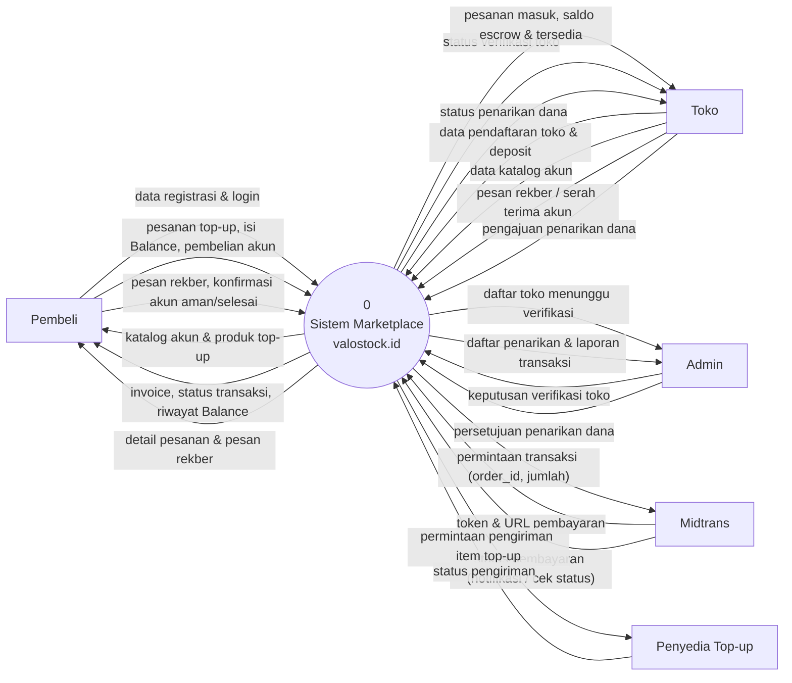

# 1. Diagram Konteks (DFD Level 0)

Diagram konteks memperlihatkan **sistem valostock.id sebagai satu proses tunggal** beserta seluruh entitas eksternal yang berinteraksi dengannya dan data yang keluar-masuk.

## Entitas Eksternal

| Entitas | Peran |
|---|---|
| **Pembeli** | Pengguna yang membeli akun game atau top-up. Tidak wajib verifikasi identitas. |
| **Toko** | Penjual. Hanya toko yang sudah membayar deposit dan **diverifikasi manual oleh Admin** yang boleh berjualan (prototype tidak memakai layanan KYC pihak ketiga). |
| **Admin** | Pengelola platform: memverifikasi toko, menyetujui penarikan dana, dan melihat laporan. |
| **Midtrans** | Payment gateway (mode **Sandbox**). Menerima permintaan pembayaran dan mengembalikan status pembayaran. |
| **Penyedia Top-up** | Pemasok item game (di dunia nyata mis. Digiflazz). **Disimulasikan** di prototype: pengiriman selalu dianggap berhasil. |

## Diagram

## Penjelasan Alur Data Utama

| Dari → Ke | Data | Keterangan |
|---|---|---|
| Pembeli → Sistem | Pesanan top-up | Game, ID akun game, nominal, kode promo, kontak, metode bayar |
| Pembeli → Sistem | Isi Balance | Nominal voucher × jumlah, metode bayar |
| Pembeli → Sistem | Pembelian akun | Katalog yang dipilih + metode bayar |
| Sistem → Midtrans | Permintaan transaksi | `order_id` (nomor invoice), `gross_amount`, data pelanggan |
| Midtrans → Sistem | Status pembayaran | `settlement` / `pending` / `expire` / `cancel` + `signature_key` |
| Toko → Sistem | Pengajuan penarikan | Jumlah, bank, nomor & nama pemilik rekening |
| Admin → Sistem | Keputusan | Setujui/tolak toko, setujui/tolak penarikan (tercatat di audit log) |
| Sistem → Penyedia Top-up | Pengiriman item | Produk + ID akun game (disimulasikan) |
