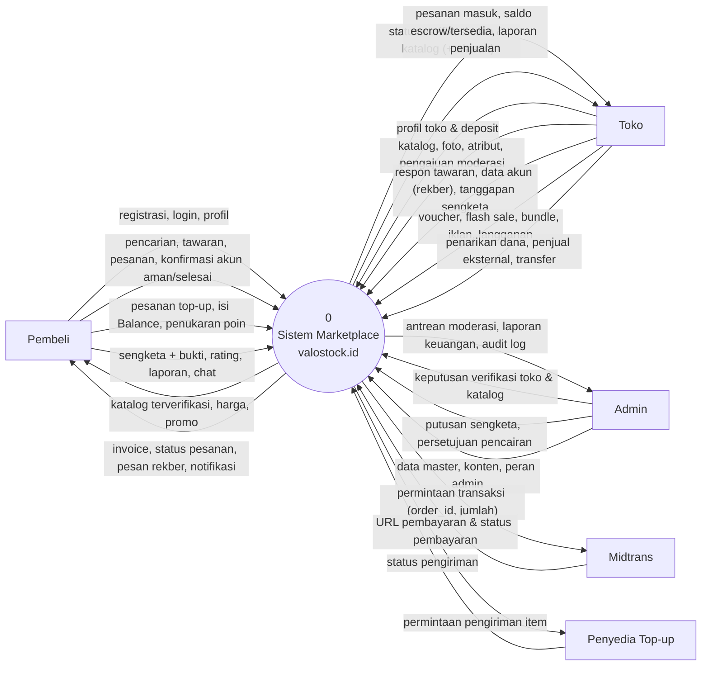

# 1. Diagram Konteks (DFD Level 0)

Diagram konteks memperlihatkan **sistem valostock.id sebagai satu proses tunggal** beserta semua entitas eksternal dan data yang keluar-masuk. Layanan pendukung milik sistem sendiri (database, autentikasi, dan penyimpanan file di Supabase) berada **di dalam** batas sistem, sehingga tidak digambar sebagai entitas eksternal.

## Entitas Eksternal

| Entitas | Peran |
|---|---|
| **Pembeli** | Membeli akun game (termasuk tawar-menawar), top-up, isi Balance, membuka sengketa, memberi rating, wishlist, mengikuti toko, chat dengan toko. |
| **Toko** | Penjual yang sudah diverifikasi admin. Mengajukan katalog untuk dimoderasi, menyerahkan akun lewat rekber, mengelola promosi, langganan, iklan, penjual eksternal, dan penarikan dana. |
| **Admin** | Memverifikasi toko dan **setiap katalog**, memutus sengketa, menyetujui pencairan dana, mengelola data master (game, produk top-up, promo), konten, dan peran admin. |
| **Midtrans** | Payment gateway (Sandbox). Menerima permintaan transaksi dan mengembalikan status pembayaran. |
| **Penyedia Top-up** | Pemasok item game (disimulasikan di proyek ini). |

## Diagram

