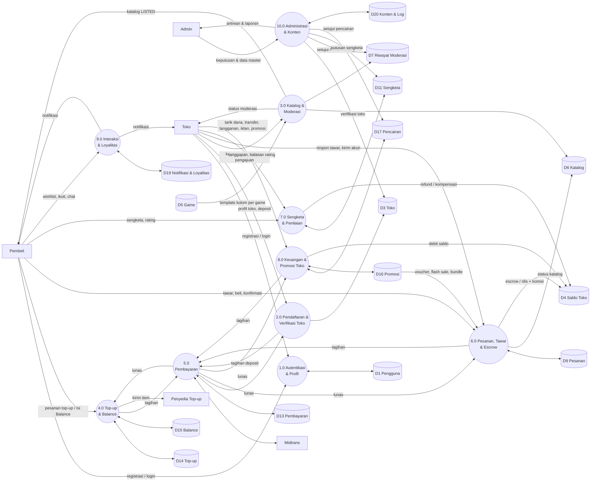
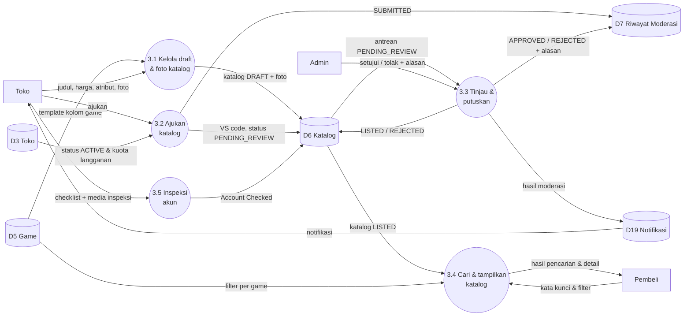
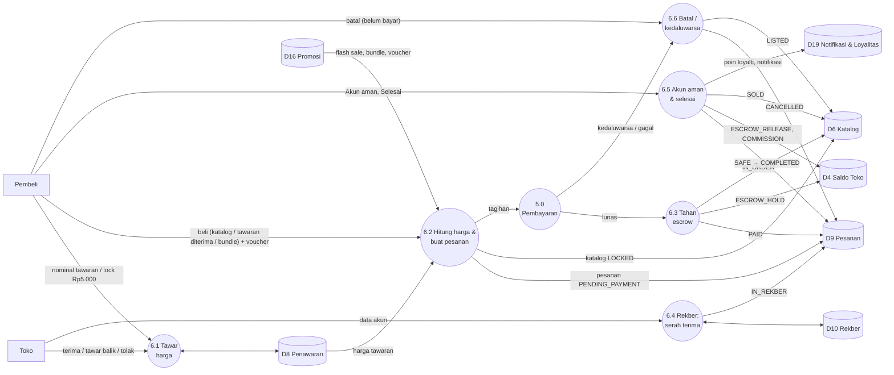
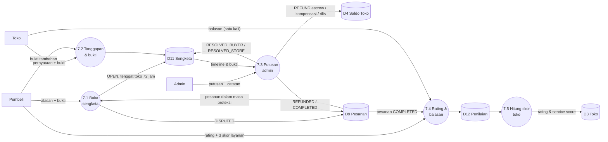
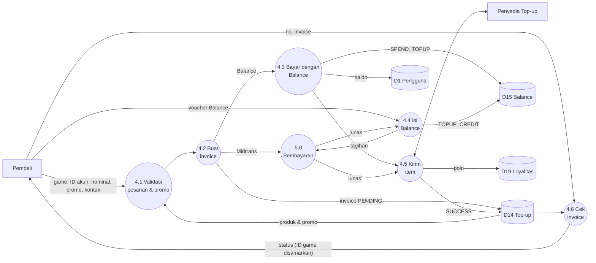

# 2. Data Flow Diagram (DFD)

## Daftar Data Store

Tabel yang berhubungan erat digabung dalam satu data store supaya diagram tetap terbaca. Rincian setiap tabel ada di [03-erd.md](03-erd.md) dan [05-struktur-tabel.md](05-struktur-tabel.md).

| Kode | Data store | Tabel |
|---|---|---|
| D1 | Pengguna | `profiles` (+ `auth.users` milik Supabase Auth) |
| D2 | Hak Akses Admin | `admin_roles`, `permissions`, `role_permissions`, `admin_user_roles` |
| D3 | Toko | `stores`, `store_subscriptions`, `store_sanctions` |
| D4 | Saldo Toko | `store_balances`, `store_ledger` |
| D5 | Game | `games`, `game_field_templates` |
| D6 | Katalog | `catalogs`, `catalog_images`, `account_inspections` |
| D7 | Riwayat Moderasi | `catalog_reviews` |
| D8 | Penawaran & Kunci | `offers`, `catalog_locks` |
| D9 | Pesanan | `orders`, `order_items` |
| D10 | Rekber | `rekber_messages` |
| D11 | Sengketa | `disputes`, `dispute_events` |
| D12 | Penilaian | `ratings` |
| D13 | Pembayaran | `payments`, `webhook_events` |
| D14 | Top-up | `topup_products`, `promo_codes`, `topup_orders` |
| D15 | Balance | `balance_topups`, `balance_ledger` |
| D16 | Promosi | `store_vouchers`, `voucher_redemptions`, `flash_sales`, `bundles`, `bundle_items`, `featured_listings` |
| D17 | Pencairan | `withdrawals`, `transfer_requests`, `external_sellers` |
| D18 | Interaksi | `wishlists`, `store_follows`, `recently_viewed`, `conversations`, `chat_messages` |
| D19 | Notifikasi & Loyalitas | `notifications`, `loyalty_ledger`, `referral_rewards` |
| D20 | Konten & Log | `news_articles`, `help_articles`, `reports`, `audit_logs` |

---

## 2.1 DFD Level 1

| No | Proses | Ringkasan |
|---|---|---|
| 1.0 | Autentikasi & Profil | Registrasi (dengan kode referral), login, reset password (Supabase Auth), ubah profil |
| 2.0 | Pendaftaran & Verifikasi Toko | Profil toko → deposit → verifikasi manual admin |
| 3.0 | Katalog & Moderasi | Toko membuat katalog + foto + atribut per game, mengajukan; admin memverifikasi; publik mencari katalog LISTED |
| 4.0 | Top-up & Balance | Top-up game, promo, isi Balance, bayar dengan Balance, cek invoice |
| 5.0 | Pembayaran | Midtrans Snap / simulasi; status dari Midtrans; penerapan status lunas |
| 6.0 | Pesanan, Tawar & Escrow | Tawar-menawar, voucher/flash sale/bundle, pesanan, escrow, rekber, akun aman, selesai |
| 7.0 | Sengketa & Penilaian | Sengketa 72 jam + putusan admin; rating + skor layanan + balasan toko |
| 8.0 | Keuangan & Promosi Toko | Penarikan, penjual eksternal + transfer, langganan, iklan, voucher, flash sale, bundle |
| 9.0 | Interaksi & Loyalitas | Wishlist, ikuti toko, baru dilihat, chat toko, notifikasi, poin, hadiah referral |
| 10.0 | Administrasi & Konten | Keputusan admin (toko, katalog, sengketa, pencairan, laporan), data master, CMS, RBAC, audit |

---

## 2.2 DFD Level 2 — Proses 3.0 Katalog & Moderasi

**Aturan:**
- Hanya toko `ACTIVE` yang bisa mengajukan, dan jumlah katalog aktif dibatasi sesuai langganan (Free 15, Pro 60, Business tanpa batas).
- VS code diterbitkan saat katalog pertama kali diajukan (unik, anti double-sell).
- Penolakan wajib disertai alasan. Toko memperbaiki lalu mengajukan ulang (kembali ke 3.2).
- Katalog `LISTED` yang diubah pada judul, harga, foto, atau atribut kembali ke `PENDING_REVIEW`.
- Publik (3.4) hanya melihat katalog `LISTED` (dan yang sedang dikunci transaksi) dari toko `ACTIVE`.

---

## 2.3 DFD Level 2 — Proses 6.0 Pesanan, Tawar & Escrow

**Aturan:** harga final = harga katalog, atau harga flash sale yang sedang berlaku, atau harga tawaran yang diterima, atau harga bundle; lalu dikurangi voucher toko. Komisi dihitung dari harga final sesuai tier langganan toko (5% / 4,5% / 4%). Pesanan yang tidak dibayar dalam 60 menit dibatalkan otomatis. **Lock opsional:** pembeli membayar Rp5.000 untuk mengunci akun selama 30 menit (tidak bisa dibeli orang lain) sebelum memutuskan membeli. **Selesai otomatis:** jika pembeli tidak menekan Selesai, pesanan otomatis selesai 5 jam setelah konfirmasi Akun aman (escrow dilepas saat itu). Penawaran kedaluwarsa setelah 24 jam, dan penawaran yang diterima berlaku 24 jam untuk dibayar.

---

## 2.4 DFD Level 2 — Proses 7.0 Sengketa & Penilaian

---

## 2.5 DFD Level 2 — Proses 4.0 Top-up & Balance

Balance bersifat **closed-loop**: hanya untuk top-up, tidak bisa ditarik tunai, tidak bisa membeli akun, dan tidak bisa ditransfer ke pengguna lain.
