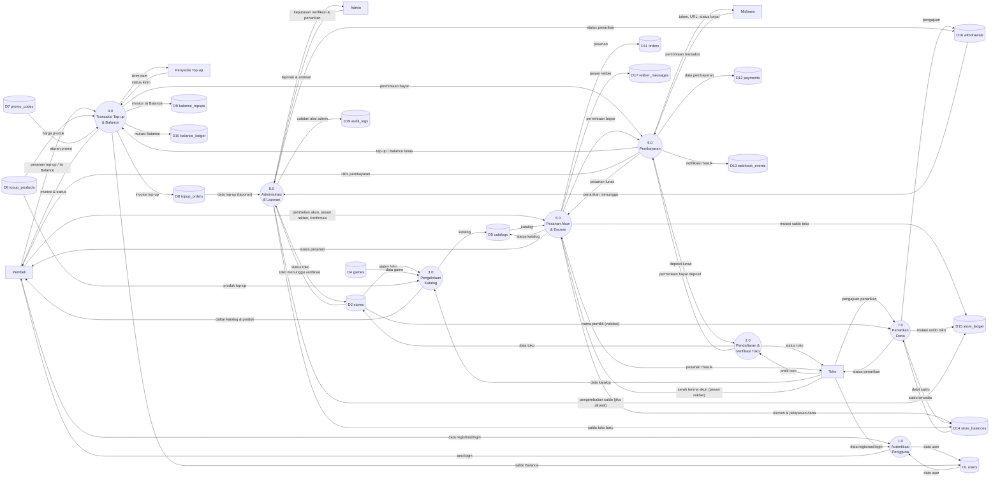
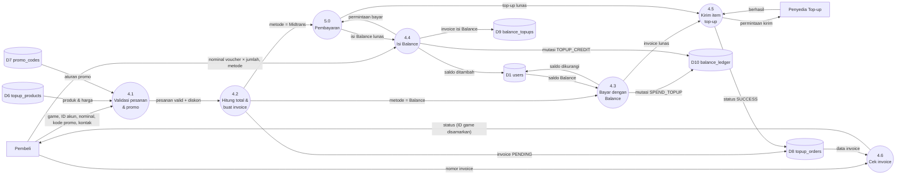
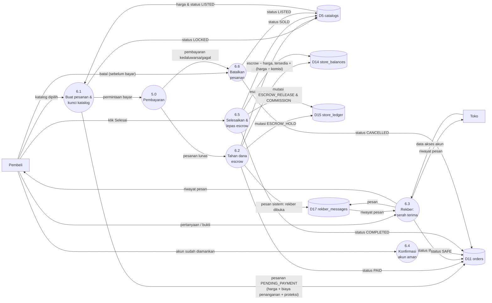

# 2. Data Flow Diagram (DFD)

## Daftar Data Store

Setiap data store sama dengan satu tabel di basis data (lihat [05-struktur-tabel.md](05-struktur-tabel.md)).

| Kode | Data store (tabel) | Kode | Data store (tabel) |
|---|---|---|---|
| D1 | users | D11 | orders |
| D2 | stores | D12 | payments |
| D3 | store_vouchers | D13 | webhook_events |
| D4 | games | D14 | store_balances |
| D5 | catalogs | D15 | store_ledger |
| D6 | topup_products | D16 | withdrawals |
| D7 | promo_codes | D17 | rekber_messages |
| D8 | topup_orders | D18 | help_articles |
| D9 | balance_topups | D19 | audit_logs |
| D10 | balance_ledger | | |

---

## 2.1 DFD Level 1

Pemecahan sistem menjadi 8 proses utama.

| No | Proses | Ringkasan |
|---|---|---|
| 1.0 | Autentikasi Pengguna | Registrasi, login, logout (email + password, sesi JWT di cookie httpOnly) |
| 2.0 | Pendaftaran & Verifikasi Toko | Isi profil toko, bayar deposit Rp500.000, diverifikasi manual oleh Admin |
| 3.0 | Pengelolaan Katalog | Toko menambah/mengubah katalog akun; publik melihat game, toko, katalog, bantuan |
| 4.0 | Transaksi Top-up & Balance | Pesan top-up, cek promo, isi Balance (closed-loop), bayar top-up dengan Balance, cek invoice |
| 5.0 | Pembayaran | Membuat transaksi Midtrans Snap, menerima/mengecek status, menerapkan status lunas |
| 6.0 | Pesanan Akun & Escrow | Buat pesanan, tahan dana (escrow), rekber, konfirmasi aman, selesai → dana dilepas ke toko |
| 7.0 | Penarikan Dana | Toko mengajukan penarikan dari saldo tersedia |
| 8.0 | Administrasi & Laporan | Admin memverifikasi toko, menyetujui/menolak penarikan, melihat laporan |

---

## 2.2 DFD Level 2 — Proses 4.0 Transaksi Top-up & Balance

**Aturan penting:**
- Balance bersifat **closed-loop**: hanya bisa dipakai untuk top-up. Tidak bisa ditarik tunai, tidak bisa membeli akun, dan tidak bisa ditransfer ke pengguna lain.
- Balance hanya bertambah (4.4) setelah proses 5.0 menyatakan pembayaran **lunas**, tidak pernah langsung dari halaman browser.
- Setiap perubahan saldo Balance selalu menulis satu baris di D10 `balance_ledger` dalam transaksi database yang sama.

---

## 2.3 DFD Level 2 — Proses 6.0 Pesanan Akun & Escrow

**Aturan penting:**
- Katalog dikunci (`LOCKED`) saat pesanan dibuat, sehingga satu akun tidak bisa dibeli dua kali.
- Komisi platform 5% dihitung dari harga akun saat pesanan **selesai**.
- **Penyederhanaan prototype:** di rancangan penuh, dana dilepas 5 jam setelah akun aman. Di prototype, dana dilepas saat pembeli menekan **Selesai** (6.5).
- Sengketa/dispute tidak termasuk cakupan prototype.
