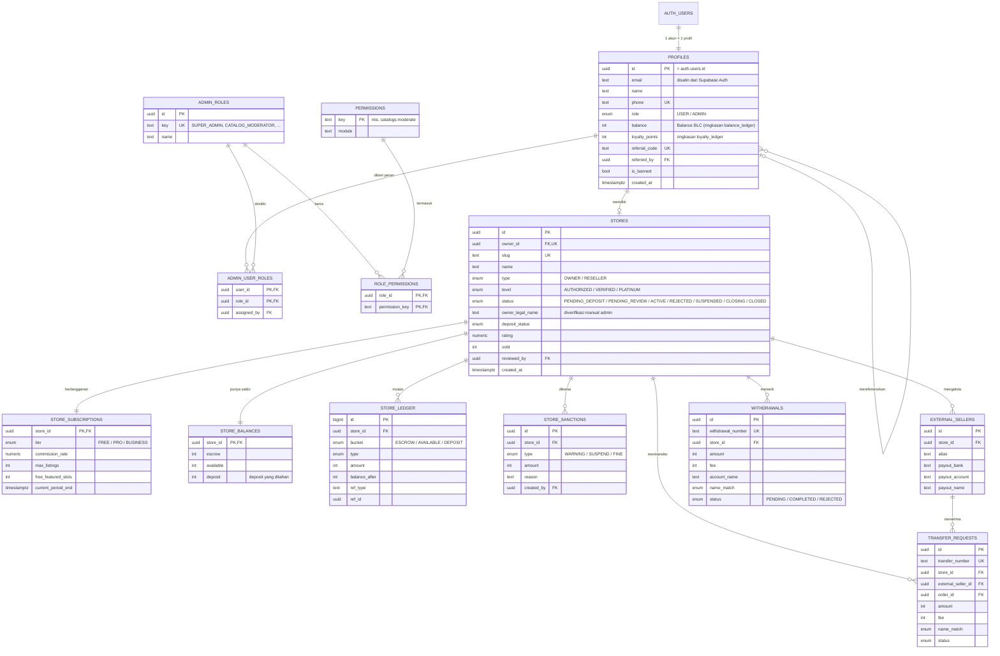
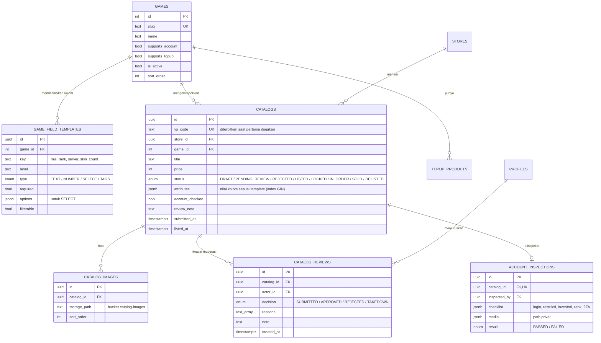
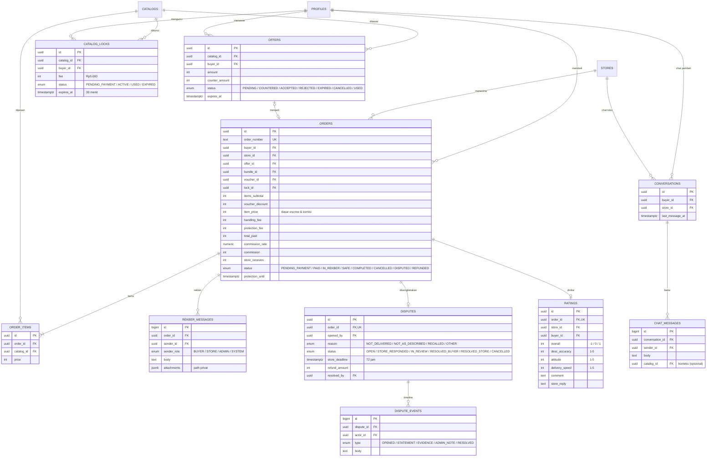
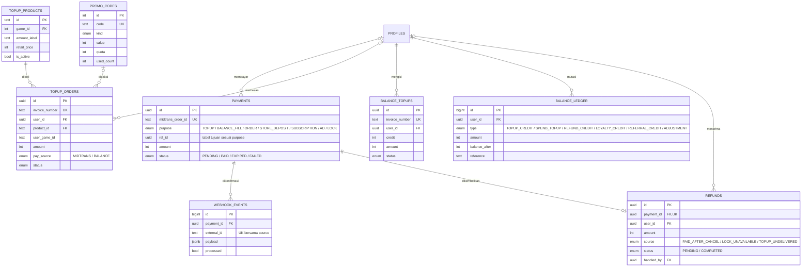
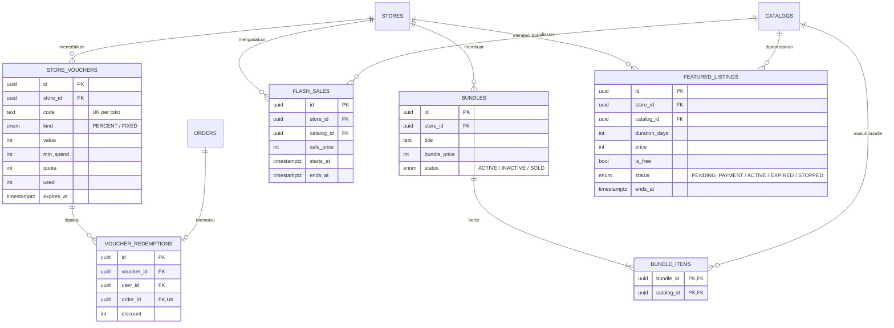
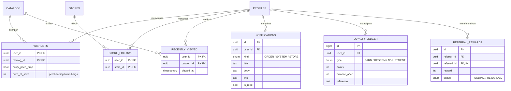
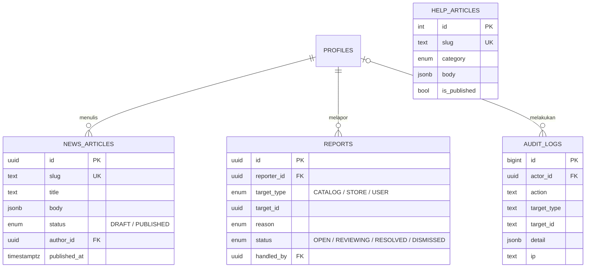

# 3. Entity Relationship Diagram (ERD)

Basis data PostgreSQL 17 pada project Supabase lokal **valostock** (schema `public`). Terdiri dari **53 tabel** dalam 7 domain. Supaya tetap terbaca, ERD dipecah per domain; tabel yang muncul di lebih dari satu diagram adalah tabel yang sama.

- Tipe data: `uuid`, `text`, `int` (uang dalam Rupiah bulat), `numeric` (rasio/skor), `bool`, `timestamptz`, `jsonb`, `enum`.
- Kardinalitas (crow's foot): `||` tepat satu · `o|` nol/satu · `|{` satu/lebih · `o{` nol/lebih.
- Tipe fisik lengkap ada di [05-struktur-tabel.md](05-struktur-tabel.md) (dibuat otomatis dari database).
- Akun login disimpan oleh **Supabase Auth** di `auth.users`. Setiap akun punya tepat satu baris `profiles` dengan id yang sama.

---

## 3.A Identitas, Akses & Toko

## 3.B Game, Katalog & Moderasi

## 3.C Transaksi Akun: Tawar, Pesanan, Rekber, Sengketa, Rating, Chat

## 3.D Pembayaran, Top-up & Balance

## 3.E Promosi & Iklan Toko

## 3.F Engagement: Wishlist, Ikuti Toko, Notifikasi, Poin, Afiliasi

## 3.G Konten & Operasional

---

## 3.H Catatan Desain

1. **Profil terhubung ke Supabase Auth.** Trigger `on_auth_user_created` membuat baris `profiles` otomatis saat akun mendaftar. Email dan password dikelola Supabase Auth dan tidak disalin ke tabel aplikasi.
2. **Moderasi katalog.** Katalog hanya tampil di marketplace jika berstatus `LISTED`. Setiap pengajuan, persetujuan, penolakan, dan penurunan dicatat di `catalog_reviews`. Perubahan data penting pada katalog `LISTED` mengembalikannya ke `PENDING_REVIEW`.
3. **Kolom katalog per game dikendalikan data.** `game_field_templates` menentukan isi `catalogs.attributes` dan filter pencarian, sehingga menambah game atau kolom baru tidak memerlukan perubahan tabel.
4. **Pesanan bisa berisi lebih dari satu akun** (untuk bundle) melalui `order_items`. Harga final (`item_price`) sudah memperhitungkan tawaran, flash sale, bundle, dan voucher. Harga final ini menjadi dasar escrow dan komisi.
5. **Relasi polimorfik `PAYMENTS`.** `purpose` + `ref_id` menunjuk ke `topup_orders`, `balance_topups`, `orders`, `stores` (deposit), `store_subscriptions`, `featured_listings`, atau `catalog_locks`. Integritasnya dijaga aplikasi.
6. **Tiga ledger.** `store_ledger` (escrow & saldo toko), `balance_ledger` (Balance pembeli), dan `loyalty_ledger` (poin). Kolom ringkasan (`store_balances`, `profiles.balance`, `profiles.loyalty_points`) hanya berubah bersama baris ledger dalam satu transaksi.
7. **Keamanan data.** RLS aktif di semua tabel tanpa policy, sehingga REST API publik Supabase tidak bisa membaca apa pun. Hanya API Express yang mengakses database. Foto katalog ada di bucket publik; media inspeksi, lampiran rekber, dan bukti sengketa ada di bucket privat (signed URL).
