# 3. Entity Relationship Diagram (ERD)

ERD prototype valostock.id terdiri dari **19 tabel**. Tipe data lengkap (panjang kolom, default, constraint) ada di [05-struktur-tabel.md](05-struktur-tabel.md).

Notasi kardinalitas (crow's foot): `||` = tepat satu, `o|` = nol atau satu, `|{` = satu atau lebih, `o{` = nol atau lebih.

## 3.1 ERD Lengkap

```mermaid
erDiagram
    USERS ||--o| STORES : "memiliki"
    USERS ||--o{ ORDERS : "membeli"
    USERS |o--o{ TOPUP_ORDERS : "memesan"
    USERS ||--o{ BALANCE_TOPUPS : "mengisi"
    USERS ||--o{ BALANCE_LEDGER : "mutasi"
    USERS |o--o{ PAYMENTS : "membayar"
    USERS |o--o{ REKBER_MESSAGES : "mengirim"
    USERS |o--o{ AUDIT_LOGS : "melakukan"

    STORES ||--|| STORE_BALANCES : "punya saldo"
    STORES ||--o{ STORE_LEDGER : "mutasi"
    STORES ||--o{ CATALOGS : "menjual"
    STORES ||--o{ ORDERS : "menerima"
    STORES ||--o{ WITHDRAWALS : "mengajukan"
    STORES ||--o{ STORE_VOUCHERS : "menerbitkan"

    GAMES ||--o{ CATALOGS : "kategori"
    GAMES ||--o{ TOPUP_PRODUCTS : "punya"
    CATALOGS ||--o{ ORDERS : "dipesan"
    TOPUP_PRODUCTS ||--o{ TOPUP_ORDERS : "dibeli"
    PROMO_CODES |o--o{ TOPUP_ORDERS : "dipakai"
    ORDERS ||--o{ REKBER_MESSAGES : "berisi"
    PAYMENTS ||--o{ WEBHOOK_EVENTS : "dikonfirmasi"

    USERS {
        varchar id PK
        varchar name
        varchar email UK
        varchar phone UK
        varchar password_hash
        enum role "USER / ADMIN"
        int balance "saldo BLC"
        datetime created_at
    }
    STORES {
        varchar id PK
        varchar owner_id FK,UK
        varchar slug UK
        varchar name
        enum type "OWNER / RESELLER"
        enum level
        enum status "PENDING_DEPOSIT / PENDING_REVIEW / ACTIVE / REJECTED / SUSPENDED"
        varchar owner_legal_name "pengganti KYC"
        int deposit_amount
        enum deposit_status
        tinyint identity_verified
        varchar reviewed_by FK
        datetime created_at
    }
    STORE_BALANCES {
        varchar store_id PK,FK
        int escrow
        int available
        datetime updated_at
    }
    STORE_LEDGER {
        bigint id PK
        varchar store_id FK
        enum bucket "ESCROW / AVAILABLE"
        enum type
        int amount
        int balance_after
        varchar ref_type
        varchar ref_id
        datetime created_at
    }
    STORE_VOUCHERS {
        varchar id PK
        varchar store_id FK
        varchar code
        enum kind
        int value
        int min_spend
    }
    GAMES {
        int id PK
        varchar slug UK
        varchar name
        tinyint supports_account
        tinyint supports_topup
        int sort_order
    }
    CATALOGS {
        varchar id PK
        varchar vs_code UK
        varchar store_id FK
        int game_id FK
        varchar title
        int price
        enum status "DRAFT / LISTED / LOCKED / IN_ORDER / SOLD / DELISTED"
        json images
        json attributes
        datetime created_at
    }
    TOPUP_PRODUCTS {
        varchar id PK
        int game_id FK
        varchar name
        varchar amount_label
        int retail_price
    }
    PROMO_CODES {
        int id PK
        varchar code UK
        enum kind
        int value
        int min_spend
        int quota
        int used_count
    }
    TOPUP_ORDERS {
        varchar id PK
        varchar invoice_number UK
        varchar user_id FK
        varchar product_id FK
        int promo_code_id FK
        varchar user_game_id
        int amount
        enum pay_source "MIDTRANS / BALANCE"
        enum status
        datetime created_at
    }
    BALANCE_TOPUPS {
        varchar id PK
        varchar invoice_number UK
        varchar user_id FK
        int nominal
        int qty
        int amount
        enum status
    }
    BALANCE_LEDGER {
        bigint id PK
        varchar user_id FK
        enum type
        int amount
        int balance_after
        varchar reference
    }
    ORDERS {
        varchar id PK
        varchar order_number UK
        varchar catalog_id FK
        varchar buyer_id FK
        varchar store_id FK
        int item_price
        int handling_fee
        int protection_fee
        int total_paid
        int commission
        enum status
        datetime created_at
    }
    PAYMENTS {
        varchar id PK
        varchar midtrans_order_id UK
        enum purpose "TOPUP / BALANCE_FILL / ORDER / STORE_DEPOSIT"
        varchar ref_id
        varchar user_id FK
        int amount
        enum status
    }
    WEBHOOK_EVENTS {
        bigint id PK
        varchar payment_id FK
        varchar external_id
        json payload
        tinyint processed
    }
    WITHDRAWALS {
        varchar id PK
        varchar withdrawal_number UK
        varchar store_id FK
        int amount
        int fee
        varchar account_name
        enum name_match
        enum status
        varchar reviewed_by FK
    }
    REKBER_MESSAGES {
        bigint id PK
        varchar order_id FK
        varchar sender_id FK
        enum sender_role
        text body
        datetime created_at
    }
    HELP_ARTICLES {
        int id PK
        varchar slug UK
        varchar title
        enum category
        json body
    }
    AUDIT_LOGS {
        bigint id PK
        varchar actor_id FK
        varchar action
        varchar target_type
        varchar target_id
        json detail
        datetime created_at
    }
```

## 3.2 Catatan Desain

1. **Relasi polimorfik `PAYMENTS`.** Satu tabel pembayaran melayani 4 jenis transaksi. Kolom `purpose` menentukan tabel tujuan dari `ref_id`: `TOPUP` → `topup_orders`, `BALANCE_FILL` → `balance_topups`, `ORDER` → `orders`, `STORE_DEPOSIT` → `stores`. Karena tujuannya berbeda-beda, relasi ini dijaga oleh aplikasi, tidak oleh FOREIGN KEY. `HELP_ARTICLES` berdiri sendiri, tanpa relasi.
2. **Saldo selalu punya jejak (ledger).** `users.balance` dan `store_balances` adalah ringkasan. Setiap perubahannya **wajib** disertai satu baris di `balance_ledger` / `store_ledger` pada transaksi database yang sama, dengan `balance_after` sebagai jejak audit.
3. **Anti double-sell.** `catalogs.vs_code` unik, dan status katalog berubah `LISTED → LOCKED → IN_ORDER → SOLD`. Satu akun tidak bisa dipesan dua kali.
4. **Pengganti KYC.** Prototype tidak memakai layanan KYC. Admin memeriksa `owner_legal_name` dan data toko secara manual, lalu mengubah `stores.status` menjadi `ACTIVE` (tercatat di `audit_logs`). Nama ini juga dipakai untuk mencocokkan nama rekening saat penarikan dana (`withdrawals.name_match`).
5. **Uang dalam Rupiah bulat (`INT`)**, tidak pernah `FLOAT`/`DOUBLE`.
