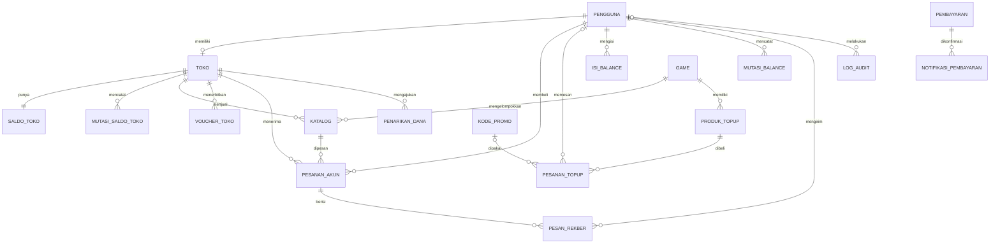

# 4. Basis Data Konseptual

Model konseptual menggambarkan **entitas, atribut kunci, dan hubungan antar-entitas** tanpa detail tipe data fisik. Detail fisiknya ada di [05-struktur-tabel.md](05-struktur-tabel.md).

## 4.1 Daftar Entitas

| No | Entitas | Deskripsi | Kunci utama | Atribut penting |
|---|---|---|---|---|
| 1 | Pengguna (users) | Semua akun: pembeli, pemilik toko, admin | id | nama, email, no. HP, password (hash), peran, saldo Balance |
| 2 | Toko (stores) | Penjual terverifikasi | id | pemilik, slug, nama, tipe, status, nama sesuai identitas, deposit |
| 3 | Saldo Toko (store_balances) | Ringkasan saldo escrow & tersedia per toko | store_id | escrow, tersedia |
| 4 | Mutasi Saldo Toko (store_ledger) | Riwayat setiap perubahan saldo toko | id | jenis mutasi, jumlah, saldo setelah, referensi |
| 5 | Voucher Toko (store_vouchers) | Kode diskon yang diterbitkan toko | id | kode, jenis, nilai, minimal belanja |
| 6 | Game (games) | Daftar game yang didukung | id | slug, nama, dukung akun/top-up |
| 7 | Katalog (catalogs) | Akun game yang dijual toko | id | kode VS, judul, harga, status, atribut game |
| 8 | Produk Top-up (topup_products) | Nominal top-up per game | id | nama, label nominal, harga jual |
| 9 | Kode Promo (promo_codes) | Promo untuk top-up | id | kode, jenis, nilai, kuota |
| 10 | Pesanan Top-up (topup_orders) | Invoice top-up game | id | no. invoice, ID akun game, total, sumber bayar, status |
| 11 | Isi Balance (balance_topups) | Invoice pembelian voucher Balance | id | no. invoice, nominal, jumlah, total, status |
| 12 | Mutasi Balance (balance_ledger) | Riwayat perubahan saldo Balance pengguna | id | jenis, jumlah, saldo setelah, referensi |
| 13 | Pesanan Akun (orders) | Pembelian akun game dengan escrow | id | no. pesanan, harga, biaya, komisi, status |
| 14 | Pembayaran (payments) | Transaksi Midtrans untuk semua jenis pembayaran | id | order_id Midtrans, tujuan, jumlah, status |
| 15 | Notifikasi Pembayaran (webhook_events) | Notifikasi status dari Midtrans (anti-duplikat) | id | id eksternal, isi notifikasi, sudah diproses |
| 16 | Penarikan Dana (withdrawals) | Pengajuan tarik dana toko | id | no. penarikan, jumlah, rekening, kecocokan nama, status |
| 17 | Pesan Rekber (rekber_messages) | Percakapan serah terima dalam satu pesanan | id | pengirim, peran, isi pesan |
| 18 | Artikel Bantuan (help_articles) | Konten pusat bantuan | id | slug, judul, kategori, isi |
| 19 | Log Audit (audit_logs) | Catatan aksi sensitif Admin/sistem | id | pelaku, aksi, target, detail, IP |

## 4.2 Relasi dan Kardinalitas

| No | Entitas A | Relasi | Entitas B | Kardinalitas | Keterangan |
|---|---|---|---|---|---|
| 1 | Pengguna | memiliki | Toko | 1 : 0..1 | Satu pengguna paling banyak memiliki satu toko |
| 2 | Toko | punya | Saldo Toko | 1 : 1 | Dibuat saat toko disetujui Admin |
| 3 | Toko | mencatat | Mutasi Saldo Toko | 1 : N | |
| 4 | Toko | menjual | Katalog | 1 : N | |
| 5 | Toko | menerbitkan | Voucher Toko | 1 : N | |
| 6 | Toko | menerima | Pesanan Akun | 1 : N | |
| 7 | Toko | mengajukan | Penarikan Dana | 1 : N | |
| 8 | Game | mengelompokkan | Katalog | 1 : N | |
| 9 | Game | memiliki | Produk Top-up | 1 : N | |
| 10 | Katalog | dipesan dalam | Pesanan Akun | 1 : N | Maksimal satu pesanan aktif sekaligus (status katalog) |
| 11 | Pengguna | membeli | Pesanan Akun | 1 : N | Sebagai pembeli |
| 12 | Pesanan Akun | berisi | Pesan Rekber | 1 : N | |
| 13 | Pengguna | mengirim | Pesan Rekber | 0..1 : N | Pesan sistem tidak punya pengirim |
| 14 | Pengguna | memesan | Pesanan Top-up | 0..1 : N | Top-up boleh tanpa login (tamu) |
| 15 | Produk Top-up | dibeli dalam | Pesanan Top-up | 1 : N | |
| 16 | Kode Promo | dipakai pada | Pesanan Top-up | 0..1 : N | Promo bersifat opsional |
| 17 | Pengguna | mengisi | Isi Balance | 1 : N | |
| 18 | Pengguna | mencatat | Mutasi Balance | 1 : N | |
| 19 | Pembayaran | membayar | Pesanan Top-up / Isi Balance / Pesanan Akun / Toko (deposit) | 1 : 1 (polimorfik) | Ditentukan kolom `purpose` + `ref_id` |
| 20 | Pembayaran | dikonfirmasi oleh | Notifikasi Pembayaran | 1 : N | Satu pembayaran bisa menerima beberapa notifikasi status |
| 21 | Pengguna (Admin) | meninjau | Toko / Penarikan Dana | 0..1 : N | Kolom `reviewed_by` |
| 22 | Pengguna | melakukan | Log Audit | 0..1 : N | Aksi sistem tidak punya pelaku |

## 4.3 Diagram Konseptual

Versi ringkas tanpa atribut, untuk memperlihatkan struktur hubungan antar-entitas.

## 4.4 Aturan Bisnis yang Tercermin di Model

| Aturan | Diterapkan melalui |
|---|---|
| Hanya toko terverifikasi yang boleh berjualan | `stores.status = 'ACTIVE'` dicek sebelum katalog dibuat atau ditampilkan |
| Satu akun = satu katalog | `catalogs.vs_code` UNIQUE + transisi status katalog |
| Dana pembeli ditahan sampai pesanan selesai | `store_balances.escrow` + mutasi `ESCROW_HOLD` / `ESCROW_RELEASE` |
| Komisi 5% dari harga akun | `orders.commission` + mutasi `COMMISSION` |
| Balance hanya untuk top-up | Tidak ada relasi antara Mutasi Balance dan Pesanan Akun |
| Penarikan hanya ke rekening atas nama pemilik toko | `withdrawals.name_match` dibandingkan dengan `stores.owner_legal_name` |
| Notifikasi pembayaran tidak diproses dua kali | UNIQUE (`source`, `external_id`) di `webhook_events` |
