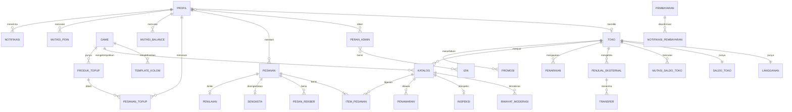

# 4. Basis Data Konseptual

Model konseptual menggambarkan **entitas, atribut kunci, dan hubungan** tanpa detail tipe fisik (lihat [05-struktur-tabel.md](05-struktur-tabel.md)).

## 4.1 Daftar Entitas

| No | Entitas (tabel) | Deskripsi | Kunci | Atribut penting |
|---|---|---|---|---|
| 1 | Profil (`profiles`) | Data aplikasi setiap akun Supabase Auth | id (= id akun) | nama, no. HP, peran, saldo Balance, poin, kode referral, status blokir |
| 2 | Peran Admin (`admin_roles`) | Kumpulan izin admin | id | key, nama |
| 3 | Izin (`permissions`) | Hak akses `modul:aksi` | key | modul |
| 4 | Izin per Peran (`role_permissions`) | Hubungan peran–izin | role_id + permission_key | — |
| 5 | Peran Pengguna (`admin_user_roles`) | Peran yang dimiliki admin | user_id + role_id | pemberi peran |
| 6 | Toko (`stores`) | Penjual terverifikasi | id | pemilik, slug, tipe, level, status, nama pemilik (KTP), deposit, rating |
| 7 | Langganan (`store_subscriptions`) | Tier toko & tarif komisi | store_id | tier, komisi, kuota katalog, berlaku sampai |
| 8 | Saldo Toko (`store_balances`) | Ringkasan escrow, saldo tersedia & deposit | store_id | escrow, tersedia, deposit |
| 9 | Mutasi Saldo Toko (`store_ledger`) | Riwayat perubahan saldo toko | id | bucket, jenis, jumlah, saldo setelah |
| 10 | Sanksi Toko (`store_sanctions`) | Peringatan/penangguhan/denda | id | jenis, jumlah, alasan |
| 11 | Penjual Eksternal (`external_sellers`) | Pemilik akun titipan (toko reseller) | id | alias, rekening, nama rekening |
| 12 | Penarikan (`withdrawals`) | Tarik dana toko | id | nomor, jumlah, biaya, kecocokan nama, status |
| 13 | Transfer (`transfer_requests`) | Pembayaran ke penjual eksternal | id | nomor, pesanan, jumlah, status |
| 14 | Game (`games`) | Master game | id | slug, nama, dukung akun/top-up |
| 15 | Template Kolom (`game_field_templates`) | Kolom katalog per game | id | key, label, tipe, wajib, bisa difilter |
| 16 | Katalog (`catalogs`) | Akun yang dijual | id | kode VS, judul, harga, status moderasi, atribut |
| 17 | Foto Katalog (`catalog_images`) | Foto di Storage | id | path, urutan |
| 18 | Riwayat Moderasi (`catalog_reviews`) | Pengajuan & keputusan admin | id | keputusan, alasan, catatan |
| 19 | Inspeksi Akun (`account_inspections`) | Checklist inspeksi toko | id | checklist, media, hasil |
| 20 | Penawaran (`offers`) | Tawar-menawar harga | id | nominal, tawaran balik, status, kedaluwarsa |
| 20a | Kunci Akun (`catalog_locks`) | Lock opsional Rp5.000 selama 30 menit | id | pembeli, biaya, status, berakhir |
| 21 | Pesanan (`orders`) | Pembelian akun dengan escrow | id | nomor, harga final, biaya, komisi, status |
| 22 | Item Pesanan (`order_items`) | Katalog dalam pesanan | id | harga |
| 23 | Pesan Rekber (`rekber_messages`) | Serah terima dalam pesanan | id | pengirim, isi, lampiran |
| 24 | Sengketa (`disputes`) | Keberatan pembeli | id | alasan, status, tenggat toko, refund |
| 25 | Timeline Sengketa (`dispute_events`) | Pernyataan, bukti, putusan | id | jenis, isi |
| 26 | Penilaian (`ratings`) | Rating + skor layanan | id | overall, 3 skor, komentar, balasan toko |
| 27 | Percakapan (`conversations`) | Chat pembeli–toko | id | terakhir aktif |
| 28 | Pesan Chat (`chat_messages`) | Isi chat | id | pengirim, isi |
| 29 | Pembayaran (`payments`) | Transaksi Midtrans | id | order_id Midtrans, tujuan, jumlah, status |
| 30 | Notifikasi Pembayaran (`webhook_events`) | Notifikasi Midtrans | id | id eksternal, isi, diproses |
| 31 | Produk Top-up (`topup_products`) | Nominal top-up | id | label nominal, harga modal, harga jual, bagian, ikon |
| 32 | Kode Promo (`promo_codes`) | Promo top-up | id | kode, jenis, nilai, kuota |
| 33 | Pesanan Top-up (`topup_orders`) | Invoice top-up | id | no. invoice, ID game, total, status |
| 34 | Isi Balance (`balance_topups`) | Invoice voucher Balance | id | no. invoice, nominal, status |
| 35 | Mutasi Balance (`balance_ledger`) | Riwayat Balance | id | jenis, jumlah, saldo setelah |
| 36 | Voucher Toko (`store_vouchers`) | Diskon dari toko | id | kode, jenis, nilai, kuota |
| 37 | Pemakaian Voucher (`voucher_redemptions`) | Voucher per pesanan | id | diskon |
| 38 | Flash Sale (`flash_sales`) | Harga promo berjangka | id | harga promo, mulai, selesai |
| 39 | Bundle (`bundles`) | Paket beberapa akun | id | judul, harga bundle |
| 40 | Isi Bundle (`bundle_items`) | Katalog dalam bundle | bundle_id + catalog_id | — |
| 41 | Iklan (`featured_listings`) | Featured listing berbayar | id | durasi, harga, status, berakhir |
| 42 | Wishlist (`wishlists`) | Katalog yang disimpan | user_id + catalog_id | notif turun harga |
| 43 | Ikuti Toko (`store_follows`) | Toko yang diikuti | user_id + store_id | — |
| 44 | Baru Dilihat (`recently_viewed`) | Riwayat melihat katalog | user_id + catalog_id | waktu |
| 45 | Notifikasi (`notifications`) | Notifikasi in-app | id | jenis, judul, isi, dibaca |
| 46 | Mutasi Poin (`loyalty_ledger`) | Riwayat poin loyalti | id | jenis, poin, saldo setelah |
| 47 | Hadiah Referral (`referral_rewards`) | Hadiah afiliasi | id | pereferensi, yang direferensikan, hadiah |
| 48 | Berita (`news_articles`) | Artikel berita | id | slug, judul, status |
| 49 | Artikel Bantuan (`help_articles`) | Pusat bantuan | id | slug, kategori |
| 50 | Laporan (`reports`) | Laporan pengguna | id | target, alasan, status |
| 51 | Log Audit (`audit_logs`) | Jejak aksi sensitif | id | pelaku, aksi, target, detail, IP |
| 52 | Refund (`refunds`) | Uang masuk yang harus dikembalikan | id | pembayaran, jumlah, sumber, status |

## 4.2 Relasi dan Kardinalitas

| No | Entitas A | Relasi | Entitas B | Kardinalitas |
|---|---|---|---|---|
| 1 | Akun (Supabase Auth) | punya | Profil | 1 : 1 |
| 2 | Profil | mereferensikan | Profil | 0..1 : N |
| 3 | Profil | diberi | Peran Admin (via Peran Pengguna) | M : N |
| 4 | Peran Admin | berisi | Izin (via Izin per Peran) | M : N |
| 5 | Profil | memiliki | Toko | 1 : 0..1 |
| 6 | Toko | punya | Langganan, Saldo Toko | 1 : 1 |
| 7 | Toko | mencatat | Mutasi Saldo, Sanksi, Penarikan | 1 : N |
| 8 | Toko | mengelola | Penjual Eksternal | 1 : N |
| 9 | Penjual Eksternal | menerima | Transfer | 1 : N |
| 10 | Game | punya | Template Kolom, Katalog, Produk Top-up | 1 : N |
| 11 | Toko | menjual | Katalog | 1 : N |
| 12 | Katalog | punya | Foto, Riwayat Moderasi | 1 : N |
| 13 | Katalog | diinspeksi | Inspeksi Akun | 1 : 0..1 |
| 14 | Katalog | ditawar | Penawaran | 1 : N |
| 15 | Pesanan | berisi | Item Pesanan | 1 : 1..N |
| 16 | Katalog | masuk dalam | Item Pesanan | 1 : N (satu yang aktif) |
| 17 | Penawaran | menjadi | Pesanan | 0..1 : 0..1 |
| 18 | Pesanan | punya | Pesan Rekber | 1 : N |
| 19 | Pesanan | punya | Sengketa, Penilaian | 1 : 0..1 |
| 20 | Sengketa | punya | Timeline Sengketa | 1 : N |
| 21 | Profil & Toko | punya | Percakapan | 1 : N |
| 22 | Percakapan | berisi | Pesan Chat | 1 : N |
| 23 | Pembayaran | membayar | Pesanan Top-up / Isi Balance / Pesanan / Deposit / Langganan / Iklan / Kunci Akun | 1 : 1 (polimorfik) |
| 24 | Pembayaran | dikonfirmasi | Notifikasi Pembayaran | 1 : N |
| 25 | Produk Top-up, Kode Promo | dipakai | Pesanan Top-up | 1 : N · 0..1 : N |
| 26 | Profil | mencatat | Mutasi Balance, Mutasi Poin, Notifikasi | 1 : N |
| 27 | Toko | menerbitkan | Voucher, Flash Sale, Bundle, Iklan | 1 : N |
| 28 | Voucher | dipakai | Pemakaian Voucher (per Pesanan) | 1 : N |
| 29 | Bundle | berisi | Katalog (via Isi Bundle) | M : N |
| 30 | Profil | menyimpan / mengikuti / melihat | Katalog / Toko / Katalog | M : N |
| 31 | Profil | membuat | Laporan, Berita, Log Audit | 1 : N |
| 32 | Pembayaran | dikembalikan lewat | Refund | 1 : 0..1 |

## 4.3 Diagram Konseptual (ringkas)

## 4.4 Aturan Bisnis yang Tercermin di Model

| Aturan | Diterapkan melalui |
|---|---|
| Hanya toko terverifikasi yang boleh berjualan | `stores.status = ACTIVE`, diputuskan admin |
| **Setiap katalog diverifikasi admin sebelum dijual** | `catalogs.status` `PENDING_REVIEW → LISTED` + `catalog_reviews` |
| Satu akun = satu katalog | `catalogs.vs_code` unik + transisi status |
| Kolom katalog mengikuti game | `game_field_templates` → `catalogs.attributes` |
| Dana ditahan sampai pesanan selesai | `store_balances.escrow` + `ESCROW_HOLD` / `ESCROW_RELEASE` |
| Komisi sesuai tier langganan | `store_subscriptions.commission_rate` disalin ke `orders.commission_rate` |
| Sengketa diputus admin | `disputes.status` + `dispute_events`, refund/kompensasi lewat ledger |
| Rating hanya dari pembelian nyata | `ratings.order_id` unik, pesanan harus `COMPLETED` |
| Balance hanya untuk top-up | tidak ada relasi Balance ke pesanan akun |
| Penarikan hanya ke rekening atas nama pemilik | `withdrawals.name_match` vs `stores.owner_legal_name` |
| Setiap keputusan admin tercatat | `audit_logs` |
| Deposit dipotong/dikembalikan lewat ledger | `store_balances.deposit` + `DEPOSIT_HOLD` / `DEPOSIT_DEDUCTION` / `DEPOSIT_REFUND` |
| Uang tanpa tujuan tidak disimpan diam-diam | `refunds` (PENDING → COMPLETED oleh admin) |
